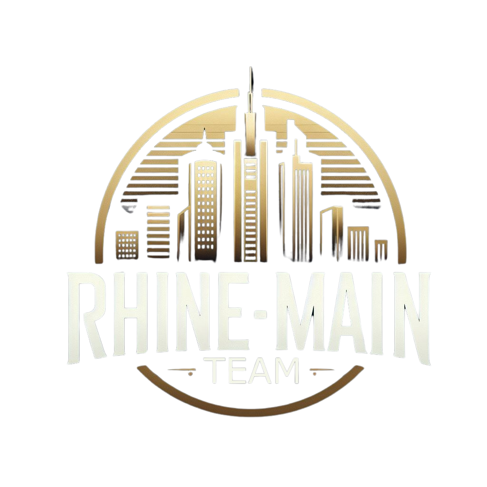
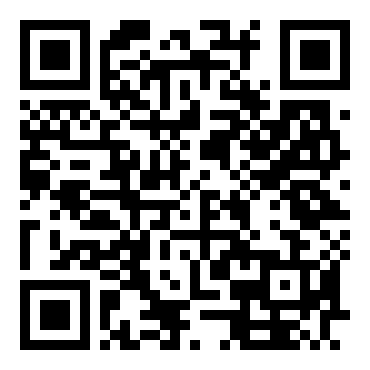

## Title of the Talk

Subtitle of the talk

ESE Kongress 2026 in Sindelfingen <!-- .element: class="ese-event" -->

Note:

Welcome the audience. Say the title of the talk.

---

### Who are we?

Speaker 1

Speaker 2

Note:

Each speaker says who they are in one or two sentences.

---

### The Talk Starts Here

Replace this slide with the content of the talk.

---

### Questions?

https://avengineers.github.io/ESE-2026/docs/_template/ <!-- .element: class="deck-url" -->

---

### Some Links

- [We@GitHub](https://github.com/avengineers)
- [Printable Slides](https://avengineers.github.io/ESE-2026/docs/_template/?print-pdf)
