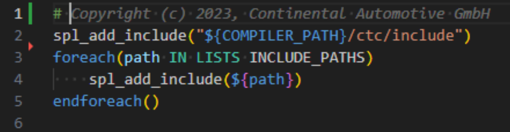
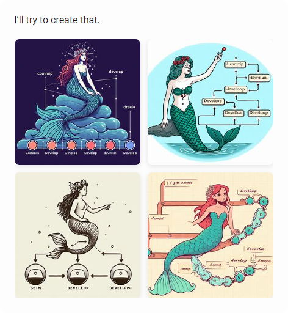
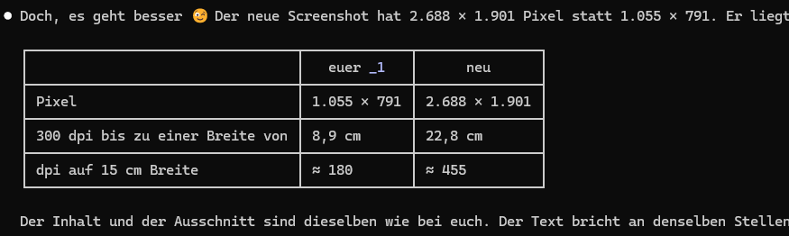

## „Frag doch den Agenten!"

<pre class="copyable"><code class="language-plaintext">Setz die User Story auf Folie 2 in SPLed um:
https://avengineers.github.io/ESE-2026/docs/ai_journey/user_story.md</code></pre>

Note:

Judith: Frag nicht mich, frag doch den Agenten!

(Judith startet den Agenten im Terminal, dann zurück zu den Folien.)

---

### Wer sind wir?

<div class="speakers">
<div class="speaker">


[Judith](https://www.linkedin.com/in/judith-reichwein-873665258/)

</div>
<div class="speaker">


[Karsten](https://www.linkedin.com/in/karnangue/)

</div>
</div>

Note:

Karsten: Wer sind wir eigentlich?

Judith: Ich bin Judith, Entwicklerin im Rhein-Main-Team. Ich kümmere mich um die SPLE
Platform, mit Schwerpunkt auf Engineering as Code und Testautomatisierung.

Karsten: Ich bin Karsten, Product Owner der SPLE Platform, unserer IDP für Embedded
Engineering. Und neuerdings kümmern wir uns beide um die Aufzucht und Erziehung von Agenten.

---

### Wer ist eigentlich der Agent?

**Agent** (vom lateinischen *agere* = handeln, treiben) bezeichnet grundsätzlich eine Person,
ein Programm oder ein System, das <span class="highlighted-yellow">in Vertretung oder im
Auftrag</span> eines anderen agiert.

<p class="deck-url">Nach: <a href="https://www.dwds.de/wb/Agent">DWDS</a> und <a href="https://de.wiktionary.org/wiki/Agent">Wiktionary</a>, Stichwort „Agent“</p>

Note:

Judith: Und wer ist eigentlich der Agent? Das Wort kommt vom lateinischen agere, handeln. Ein
Agent handelt in Vertretung oder im Auftrag eines anderen.

Karsten: So wie eben: Ich habe ihm als Product Owner die Story gegeben. Und während er arbeitet,
erzählen wir euch, wie es dazu kam.

---

### 2022: Ein Schülerpraktikant im Editor

<div class="agent-face"></div>

- Code Completion
- Python, CMake, C++, GoogleTest
- Architektur bleibt bei uns
- Vorschläge klingen gut

 <!-- .element: class="fragment" style="width: 80%; margin: 0;" -->

Note:

Judith: Angefangen hat es 2022 mit der Code Completion. Sie schlägt mal eine Funktion vor, mal
eine Schleife. Die Syntax musste ich nicht mehr im Kopf haben, bei Python, CMake, C++ und
GoogleTest. Die Architektur kam weiter von uns. Die Vorschläge klangen immer gut, aber oft waren
sie falsch. Also haben wir jede Zeile geprüft, so wie man die Arbeit eines Praktikanten prüft.

(Judith: Bild einblenden)

Judith: Hier schlägt sie in einer CMake-Datei von uns als erste Zeile den Copyright-Kommentar
einer ganz anderen Firma vor. Klingt gut, sieht richtig aus, ist falsch.

---

### Chatbots halfen auch mit

- Skripte, kleine VS-Code-Erweiterungen
- Läuft? Übernommen!
- Heute: *Vibe Coding*

Note:

Karsten: Dann kamen die Chatbots. Die haben uns Skripte geschrieben oder kleine Erweiterungen für
VS Code.

Judith: Heute nennt man das Vibe Coding: Es läuft, also übernimmt man es. Aber nicht alles kann
man ungesehen übernehmen. Mein Lieblingsbeispiel, wenn die KI mal wieder Mist gemacht hat:

(Judith: nächste Folie)

---

Can you create a mermaid diagram showing a git history of 4 commits and a develop branch
that points to the latest commit?

 <!-- .element: class="fragment" style="width: 472px; margin: 0;" -->

Note:

Judith: Ich wollte nur ein kleines Mermaid-Diagramm, also ein Diagramm, das man als Text
schreibt: eine Git-History mit vier Commits und einem Branch develop.

Karsten: Und? Das konnte er doch sicherlich ohne Probleme erstellen?

Judith: Kommt drauf an. Als nettes Kunstwerk im Büro? Vielleicht. Das kam dabei raus:

(Judith: Antwort einblenden)

Judith: „I'll try to create that.“ Und dann vier Meerjungfrauen, mit Branches, die „develoop“
und „Develice“ heißen. Und „GEIM“!

---

### Ende 2025: Der Wendepunkt

- Neue Modelle, z. B. Claude Opus 4.5
- Schulung: agentische Entwicklung
- Repository lesen, bauen, testen, Fehler korrigieren
- Erste Skills ausprobiert

<p class="fragment"><strong>„Frag doch den Agenten!“</strong></p>

Note:

Karsten: Die ersten Agenten haben wir benutzt wie die Code Completion, nur mit Prompts. Ende
2025 kamen neue Modelle, und unser Team hat eine Schulung zu agentischer Entwicklung besucht. Da
haben wir gesehen, was ein Agent kann: Er liest das Repository, schreibt Code, baut, testet und
korrigiert seine eigenen Fehler. Und in der Schulung haben wir zum ersten Mal Skills
ausprobiert. Dazu gleich mehr.

(Karsten: Fazit einblenden)

Karsten: Seitdem heißt bei uns die Antwort auf fast jede Frage: Frag doch den Agenten! Wie
Judith ja bereits gezeigt hat.

---

### „Mein Agent programmiert besser als deiner!“

- Eigene `AGENTS.md`
- Eigene Skill-Sammlungen
- Gleiches Projekt, andere Ergebnisse

Note:

Judith: Dann hat jeder angefangen, seinen eigenen Werkzeugkasten zu pflegen: eine eigene
AGENTS.md mit eigenen Regeln, eigene Skills. Dasselbe Projekt liefert dann verschiedene
Ergebnisse, je nachdem, wer fragt.

Karsten: Was ist eigentlich ein Skill?

(Judith: nächste Folie)

---

### Skills: Wie wir Agenten steuern

<div class="joined-code">

```yaml
---
name: c-unit-testing
description: Write GTest/GMock unit tests for embedded
  C components using Arrange-Act-Assert and
  hammocking. […]
---
```

```markdown
# GTest Unit Testing for Embedded C

## First Contact

1. Which component? — Ask for the component path
2. What's the goal? — New tests from scratch, add
   tests for a specific function, fix a failing test,
   or refactoring safety net? […]
```

</div>

<p class="deck-url">Quelle: <a href="https://github.com/avengineers/sple-skills">avengineers/sple-skills</a>, MIT-Lizenz</p>

Note:

Judith: Ein Skill ist eine Anleitung in Textform. Der Agent lädt sie, sobald eine Aufgabe dazu
passt. Sie beschreibt, wie er eine wiederkehrende Aufgabe erledigen soll: Werkzeuge,
Konventionen, Prüfungen am Ende. Der Skill befähigt ihn. Hier seht ihr einen Ausschnitt aus
unserem Skill für Unit-Tests in Embedded C.

---

### Skills als Produkt eines Plattform-Teams

- Werkzeuge, Schulungen – und Skills
- Für Unit-Tests, Build, Testbericht
- Ein gemeinsamer Stand für alle

Note:

Karsten: Als Plattform-Team liefern wir neben Werkzeugen und Schulungen jetzt auch Skills: für
Unit-Tests, für den Build, für den Testbericht. Niemand muss diese Regeln auswendig kennen, der
Agent lädt sie. So wird aus vielen persönlichen Setups ein gemeinsamer Stand.

Judith: Alles gut und schön. Aber wie benutzen wir die Skills denn konkret im Alltag?

---

### Der Product-Owner-Agent

<div class="agent-face"></div>

- User Stories, Sprintplanung
- Einheitliches Format
- Großes Kontextfenster: denkt an mehr Fakten
- Aber: zu viele Details für Menschen

Note:

Karsten: Ganz einfach: Ich schreibe dem Agenten „Let's refine“ oder „Let's create a user
story“. Daran erkennt er die Aufgabe, lädt unseren Skill fürs Refinement, und schon arbeitet er
als Product Owner. Dann schreibt er User Stories und bereitet die Sprintplanung vor, immer im
gleichen Format. Durch sein großes Kontextfenster denkt er an Fakten, die ein Mensch oft
vergisst. Der Nachteil: Für Menschen sind es oft zu viele Details.

Judith: Auch die User Story auf Folie 2 hat der Agent geschrieben. Was er daraus gemacht hat,
sehen wir am Ende.

Karsten: Und was hast du so für Agenten auf Lager?

(Judith: nächste Folie)

---

### Der Consultant-Agent

<div class="agent-face"></div>

<div class="flex-container" style="align-items: flex-start;">
<div class="half">

<div class="mermaid git-graph">
<pre>
---
config:
  theme: base
  themeVariables:
    git0: "#4dd0e1"
    git1: "#ffd54f"
    gitBranchLabel0: "#002b36"
    gitBranchLabel1: "#002b36"
    commitLabelColor: "#ffffff"
    commitLabelBackground: transparent
    commitLabelFontSize: 16px
    fontSize: 16px
  gitGraph:
    mainBranchName: develop
---
gitGraph TB:
  commit id: "423436d: draft the article"
  commit id: "3041588: add figure 2" type: HIGHLIGHT
  commit id: "9e6d4c7: apply the review"
  branch feat/ai-journey-slides
  commit id: "ce8a99a: draft the slides"
  commit id: "4e2722f: tighten the slides"
  commit id: "6a7a0a6: show a code completion"
  commit id: "dc38026: highlight the skill excerpt"
</pre>
</div>

</div>
<div class="half" style="flex: 1.4; width: auto;">

 <!-- .element: id="better-screenshot" class="fragment" data-fragment-index="0" style="width: 100%; margin-top: 0;" -->

</div>
</div>

<svg class="slide-arrow fragment" data-fragment-index="0" data-arrow-from=".git-graph .commit-highlight-outer" data-arrow-to="#better-screenshot"></svg>

Note:

Judith: Als Berater hat uns der Agent bei genau diesem Vortrag geholfen. Links seht ihr seine
Commits: auf develop der Artikel für den Tagungsband, daneben die Arbeit an diesen Folien. Das
ist übrigens ein echtes Mermaid-Diagramm.

Karsten: Und wo hilft er konkret?

Judith: Naja, wir hatten die Anforderungen des Tagungsbands gar nicht vor Augen. Aber wir haben
sie dem Agenten als Kontext mitgegeben. Dadurch hat er erkannt, dass unsere Screenshots
nicht den Anforderungen genügen.

(Judith: Screenshot einblenden)

Judith: Und er hat uns gezeigt, dass er es besser kann.

Karsten: Und wo helfen uns Agenten in der Softwareentwicklung?

(Judith: nächste Folie)

---

### Der Review-Agent

<div class="agent-face"></div>

- Pull Request mit 2.000 Zeilen
- Agent prüft, Mensch bewertet
- Mensch entscheidet

Note:

Judith: Zum Beispiel als Review-Agent. Jeder kennt das: Ein Pull-Request-Review steht an, und
man schaut auf 2.000 Zeilen fremden Code. Heute prüft der Agent die ganze Änderung, und wir
bewerten seine Befunde. Die Entscheidung bleibt bei uns.

Judith: Aber das ist nur ein Aspekt der Softwareentwicklung. Wie stellst du dir eigentlich das
Zielbild für Agentic Software Engineering vor?

(Karsten: nächste Folie)

---

### Unser Zielbild: Closed Loop Engineering

<div class="mermaid loop-graph fragment" data-fragment-index="0">
<pre>
---
config:
  theme: base
  themeVariables:
    fontSize: 30px
    lineColor: "#ffffff"
  flowchart:
    curve: basis
---
flowchart LR
  req(["Anforderungen"]):::human <-- Refinement --> story["User Story"]:::agent
  story --> plan["Plan"]:::agent
  plan --> tdd["TDD"]:::agent
  tdd --> review["Review"]:::agent
  review --> gate["Gate"]:::agent
  gate -- grün --> accept(["Abnahme"]):::human
  review -. Befund .-> tdd
  gate -. rot .-> tdd
  linkStyle 0 color:#ffffff
  linkStyle 5 stroke:#76FF03,stroke-width:3px,color:#76FF03
  linkStyle 7 stroke:#FF8A80,stroke-width:3px,color:#FF8A80
  linkStyle 6 color:#ffffff
  classDef human fill:#ffd54f,stroke:#ffd54f,color:#002b36
  classDef agent fill:#4dd0e1,stroke:#4dd0e1,color:#002b36
</pre>
</div>

<p class="deck-url fragment" data-fragment-index="0"><span class="highlighted-yellow">Gelb:</span> Mensch · <span class="highlighted-cyan">Blau:</span> Agent</p>

Note:

Karsten: Ich will dahin, dass der Mensch nur noch am Anfang und am Ende steht. Dazwischen
arbeitet der Agent in einer geschlossenen Schleife: Er prüft seine Arbeit selbst und bessert
nach, bis sie nachweislich fertig ist. Das nennen wir Closed Loop Engineering.

Judith: Klingt gut. Und wie sieht das im Detail aus?

(Karsten: Flowchart einblenden)

Karsten: Am Anfang bringt der Mensch die Anforderungen mit, und im Refinement schreibt der Agent
mit ihm die User Story. Daraus macht der Agent einen Plan aus kleinen Tasks und setzt jeden
testgetrieben um. Ein zweiter Agent prüft die Änderung gegen unsere Kriterien. Am Ende läuft das
Gate: alle Tests, der Lint, die CI. Fertig ist die Arbeit erst, wenn das Gate grün ist, nicht
wenn ein Agent sagt, es sei gut. Dann nimmt der Mensch ab, und das Urteil fällen wir.

Judith: Okay, dann schauen wir doch mal, was unser aktuelles Setup so liefern kann und wie eine
Abnahme aussieht.

(Judith: nächste Folie)

---

### Die Abnahme

- Anforderungen ↔ SW Detailed Design (SWDD)
- SWDD ↔ Code
- SWDD ↔ Tests
- Tests ↔ Testergebnisse
- UAT: Geht das Licht nach 10 Sekunden aus?

<p class="fragment"><strong>Angenommen?</strong></p>

Note:

(Judith wechselt ins Terminal.)

Judith: Dann schauen wir mal, was der Agent geliefert hat. SWDD heißt Software Detailed Design.
Ich gehe die Liste von oben nach unten durch: Verweist das Detailed Design auf die drei
Anforderungen? Verweisen Code und Tests auf das Design? Sind die Tests grün, und zeigt der
Bericht Coverage und Traceability? Und geht das Licht nach 10 Sekunden aus?

(Judith zeigt zu jedem Punkt das Ergebnis und sagt, was ihr auffällt: Ist es gut lesbar? Was hat
der Agent entschieden, wo die Anforderungen nichts sagen?)

(Judith: Fazit einblenden)

Judith: Was meint ihr: angenommen? Mein Urteil: …

(Judith: angenommen, mit Fragen zurück oder abgelehnt, ehrlich bewertet. Ist der Agent nicht
fertig, zeigt sie den Stand oder einen Probelauf und sagt, was sie zeigt.)

---

### Fazit

- Praktikant ist jetzt Mitarbeiter
- Wir sind Chefs von Agenten
- Skills und Qualitätskriterien passen sie an

<div class="fragment">

**Was meint ihr?**

- Wie sieht euer Workflow aus?
- Wie viel Kontrolle braucht ein Agent?

</div>

Note:

Karsten: Aus dem Praktikanten ist ein Mitarbeiter geworden. Er schreibt Code, Tests,
Dokumentation, User Stories und Präsentationen. Wir sind die Chefs: Wir geben die Aufgabe vor,
und das Urteil fällen wir. Mit Skills und Qualitätskriterien passen wir die Agenten an unsere
Umgebung an.

(Karsten: Fragen einblenden)

Judith: Jetzt seid ihr dran. Wie sieht euer Workflow mit Agenten aus? Und wie viel Kontrolle
braucht ein Agent? Unsere Antwort heute: ein Prompt von einer Zeile, und der Agent entscheidet
selbst. Was meint ihr?

---

### Questions?

<div class="qr">


</div>

https://avengineers.github.io/ESE-2026/docs/ai_journey/ <!-- .element: class="deck-url" -->

---

### Some Links

- [We@GitHub](https://github.com/avengineers)
- [Printable Slides](https://avengineers.github.io/ESE-2026/docs/ai_journey/?print-pdf)
