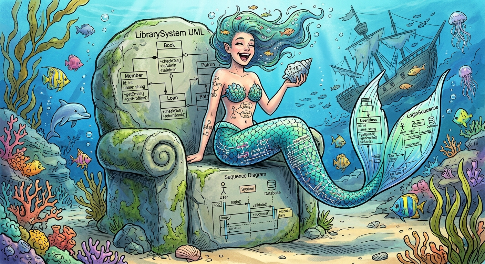

## „Frag doch den Agenten!"

```text
Setz die User Story auf Folie 2 in SPLed um:
https://avengineers.github.io/ESE-2026/docs/ai_journey/user_story.md
```

Note:

Judith hat die Folie davor zum ersten Mal gesehen und reagiert genervt und gestresst: „Jetzt? Ich
halte gerade einen Vortrag!“ Pause. Dann: „Frag doch den Agenten!“

Judith wechselt ins Terminal, fügt den vorbereiteten Prompt ein und startet den Agenten. Das
Terminal bleibt kurz sichtbar, dann zurück zu den Folien.

Die Datei user_story.md ist die Folie davor. Der Agent liest sie allein, ohne den Rest des
Decks. Deshalb stehen dort keine Notizen.

---

### Wer sind wir?

<div class="speakers">
<div class="speaker">


[Judith](https://www.linkedin.com/in/judith-reichwein-873665258/)

</div>
<div class="speaker">


[Karsten](https://www.linkedin.com/in/karnangue/)

</div>
</div>

Note:

Jede Person sagt in ein oder zwei Sätzen, wer sie ist. Dann: „Und während unser Agent arbeitet,
erzählen wir euch, wie es dazu kam.“

---

### 2022: Ein Schülerpraktikant im Editor

- Code Completion schlägt vor: mal eine Funktion, mal eine Schleife
- Die Syntax muss man nicht mehr im Kopf haben
- Eine große Hilfe bei Python, CMake, C++, GoogleTest und Dokumentation
- Struktur und Architektur kommen weiter von uns

Note:

Judith. Kapitel 1 des Artikels. Das Werkzeug entlastet bei Routineaufgaben, und wir gewinnen
Zeit für die kreative Arbeit.

---

### Die Vorschläge klingen immer gut

- Trotzdem sind sie oft falsch: Der Code läuft nicht, vieles ist halluziniert
- Wir prüfen jede Zeile, wie bei einem Praktikanten

Note:

Judith. Überleitung zum Bild auf der nächsten Folie: „Ein Beispiel.“

---

### Wir wollten ein Mermaid-Diagramm

 <!-- .element: style="height: 480px; margin: 0;" -->

Note:

Judith. Unser Prompt war: ein Mermaid-Diagramm. Die Antwort: eine Meerjungfrau, mermaid, mit
UML-Diagrammen auf dem Thron und auf der Flosse. Die Antwort klingt gut, sie sieht sogar gut
aus, und sie ist trotzdem falsch.

---

### Dann kam ChatGPT

- Ein Skript hier, eine kleine Erweiterung für VS Code da
- Lief das Ergebnis, haben wir es übernommen, ohne jede Zeile zu verstehen
- Heute heißt das *Vibe Coding*

Note:

Judith. Hier waren wir weniger streng als bei der Code Completion. Das kommt später wieder.

---

### Ende 2025: Der Wendepunkt

- Neue Modelle, zum Beispiel Claude Opus 4.5
- Eine Schulung zu agentischer Entwicklung gibt uns einen neuen Blick
- Vorher: „Schreib mir bitte eine Funktion, die das und das macht.“
- Jetzt: eine ganze User Story oder ein ganzes Feature

Note:

Karsten. Kapitel 2 des Artikels. Die ersten Agenten haben wir benutzt wie die Code Completion,
nur mit Prompts. Die Trainer haben uns gezeigt, was ein Agent sonst noch kann.

---

### Was ein Agent kann

- Er liest das Repository
- Er schreibt Code, führt Befehle aus, baut und testet
- Er korrigiert seine eigenen Fehler
- Über MCP erreicht er Ticketsystem und CI-Server

<p class="fragment">Und auf fast jede Frage im Team heißt die Antwort: <strong>„Frag doch den Agenten!“</strong></p>

Note:

Karsten. MCP ist das Model Context Protocol. Der Satz am Schluss ist der Titel des Vortrags.

---

### „Meine Claude programmiert besser als deiner!“

- Im Unternehmen ist GitHub Copilot verbreitet, im Team arbeitet jeder mit Claude Code
- Jeder pflegt seinen eigenen Werkzeugkasten:
  - eine persönliche `CLAUDE.md` mit eigenen Regeln
  - bevorzugte Skill-Sammlungen
  - selbst geschriebene Skills
- Dasselbe Projekt liefert verschiedene Ergebnisse, je nachdem, wer fragt

Note:

Judith. Kapitel 3 des Artikels. Eine saubere Begründung für Claude Code haben wir nicht, nur die
gemeinsame Beobachtung, dass es für unsere Arbeit besser passt.

Offen sagen: Der Agent, der gerade für uns arbeitet, läuft mit Karstens Setup. Es ist „seine
Claude“.

---

### Skills: Wie wir Agenten steuern

```text
---
name: c-unit-testing
description: Write GTest/GMock unit tests for embedded
  C components using Arrange-Act-Assert and
  hammocking. […]
---

# GTest Unit Testing for Embedded C

## First Contact

1. Which component? — Ask for the component path
2. What's the goal? — New tests from scratch, add
   tests for a specific function, fix a failing test,
   or refactoring safety net? […]
```

<p class="deck-url">Quelle: <a href="https://github.com/avengineers/sple-skills">avengineers/sple-skills</a>, MIT-Lizenz</p>

Note:

Karsten. Ein Skill ist eine Anleitung in Textform. Der Agent lädt sie, sobald eine Aufgabe dazu
passt. Sie sagt, wie ein Team eine Aufgabe in seiner Umgebung erledigt: Werkzeuge, Konventionen,
Prüfungen am Ende. Das ist ein Ausschnitt aus unserem Skill für Unit-Tests in Embedded C.

---

### Skills als Produkt eines Plattform-Teams

- Wir liefern Werkzeuge, Schulungen und jetzt auch Skills
  - Wie schreibt man gute Unit-Tests?
  - Wie startet man einen Build?
  - Wie erzeugt man einen Testbericht?
- Der Entwickler muss die Regeln nicht auswendig kennen: Sein Agent lädt sie
- Aus vielen persönlichen Setups wird ein gemeinsamer Stand

Note:

Karsten. Damit ist die Frage von eben beantwortet: Wie passt man einen Agenten an eine
Umgebung an?

---

### Der Agent schreibt das Backlog

- User Stories, Backlog-Einträge, Vorbereitung der Sprintplanung
- Immer im gleichen Format
- Das große Kontextfenster hilft: Er denkt an Fakten, die ein Mensch oft vergisst
- Schnell eine Grundlage, über die das Team diskutieren kann
- Aber: Für einen Menschen sind es oft zu viele Details

Die User Story auf Folie 2 hat der Agent geschrieben. Und das Ticket für diese Folien auch. <!-- .element: class="fragment" -->

Note:

Karsten. Kapitel 4 des Artikels, zweites Beispiel. Das erste Beispiel, Automotive SPICE, läuft
gerade im Hintergrund. Wir zeigen es am Ende.

Entwurf: Hier kann eine bereinigte Kopie des Tickets für die Folien hin, ohne Ticket-Nummer und
ohne interne Links.

---

### Folien als Code

````text
### Folien als Code

- Präsentationen in Markdown, mit reveal.js
- Sie liegen als Text in einem Git-Repository
- Wir prüfen und ändern sie wie Code
````

- Das ist der Quelltext einer Folie wie dieser
- Der Agent schreibt auch Tabellen und Dokumente in den gängigen Office-Formaten

Note:

Judith. Kapitel 4 des Artikels, drittes Beispiel. Diese Folien sind genau so entstanden: zwei
Menschen und ein Agent.

---

### Jede Antwort klingt gut

- Schon 2022 klangen die Vorschläge immer gut. Das ist geblieben.
- Geändert hat sich, wie oft sie stimmen
- Wenn fast alles stimmt, fällt der eine Fehler kaum noch auf

Note:

Judith und Karsten im Dialog. Kapitel 5 des Artikels.

---

### Vibe Coding: wann ja, wann nein

- Für ein Skript, das wir einmal ausführen und dann löschen: in Ordnung
- Für produktiven Code, der wiederverwendet wird: nein
- Im Embedded-Umfeld kann niemand Code freigeben oder warten, den er nicht versteht

Note:

Judith: „Was ich nicht verstehe, kann ich nicht freigeben.“

---

### Der Agent hilft beim Bewerten

- Ein Pull Request mit 2.000 geänderten Zeilen: früher kaum zu prüfen
- Heute prüft der Agent die ganze Änderung, der Mensch bewertet seine Befunde
- Die letzte Entscheidung liegt weiter beim Menschen

Und genau das machen wir jetzt mit unserem Agenten. <!-- .element: class="fragment" -->

Note:

Karsten. Der Satz am Schluss leitet zur Demo über.

---

### Was hat der Agent geliefert?

- Detailed Design
- Testspezifikation
- Feature-Schalter im Feature-Modell
- Code und Unit-Tests
- Komponentenbericht mit Coverage und Traceability
- Seine Fragen: Was haben die Anforderungen offengelassen?

Note:

Judith wechselt ins Terminal und zeigt das Ergebnis. Ist der Agent nicht fertig, zeigt sie, was
bis jetzt fertig ist, oder das Ergebnis aus einem Probelauf. Sie sagt offen, was sie zeigt.

---

### Die Abnahme

- Stimmt es? Tests grün, Anforderungen abgedeckt
- Passt es zu unserer Architektur und Arbeitsweise?
- Kann ein Mensch es gut lesen?
- Welche Fragen hat der Agent gestellt, und was hat er stillschweigend entschieden?

Angenommen, mit Fragen zurück oder abgelehnt? <!-- .element: class="fragment" -->

Note:

Karsten nimmt als Product Owner ab, nach den Akzeptanzkriterien von Folie 2 und nach diesen
Fragen. Ehrlich bewerten, auch wenn etwas schiefgegangen ist.

---

### Aus dem Praktikanten ist ein Kollege geworden

- Er schreibt Code, Tests, Dokumentation, User Stories und Präsentationen
- Mit Skills passen wir ihn an unsere Umgebung an
- Seine Ergebnisse bewerten wir weiter selbst
- Dabei hilft er uns, aber das Urteil fällen wir

Note:

Karsten. Die Zusammenfassung des Artikels. Auch der Artikel ist so entstanden: zwei Menschen und
ein Agent.

---

### Zur Diskussion

- Ist ein möglichst kurzer Prompt besser, der dem Agenten viel Freiheit lässt?
- Oder soll der Agent lieber alles nachfragen?
- Wie viel Kontrolle braucht ein Agent?

Note:

Unsere Antwort von heute: ein Prompt von einer Zeile, und der Agent sammelt seine Fragen, statt
nachzufragen. Was meint ihr?

---

### Questions?

<div class="qr">


</div>

https://avengineers.github.io/ESE-2026/docs/ai_journey/ <!-- .element: class="deck-url" -->

---

### Some Links

- [We@GitHub](https://github.com/avengineers)
- [Printable Slides](https://avengineers.github.io/ESE-2026/docs/ai_journey/?print-pdf)
