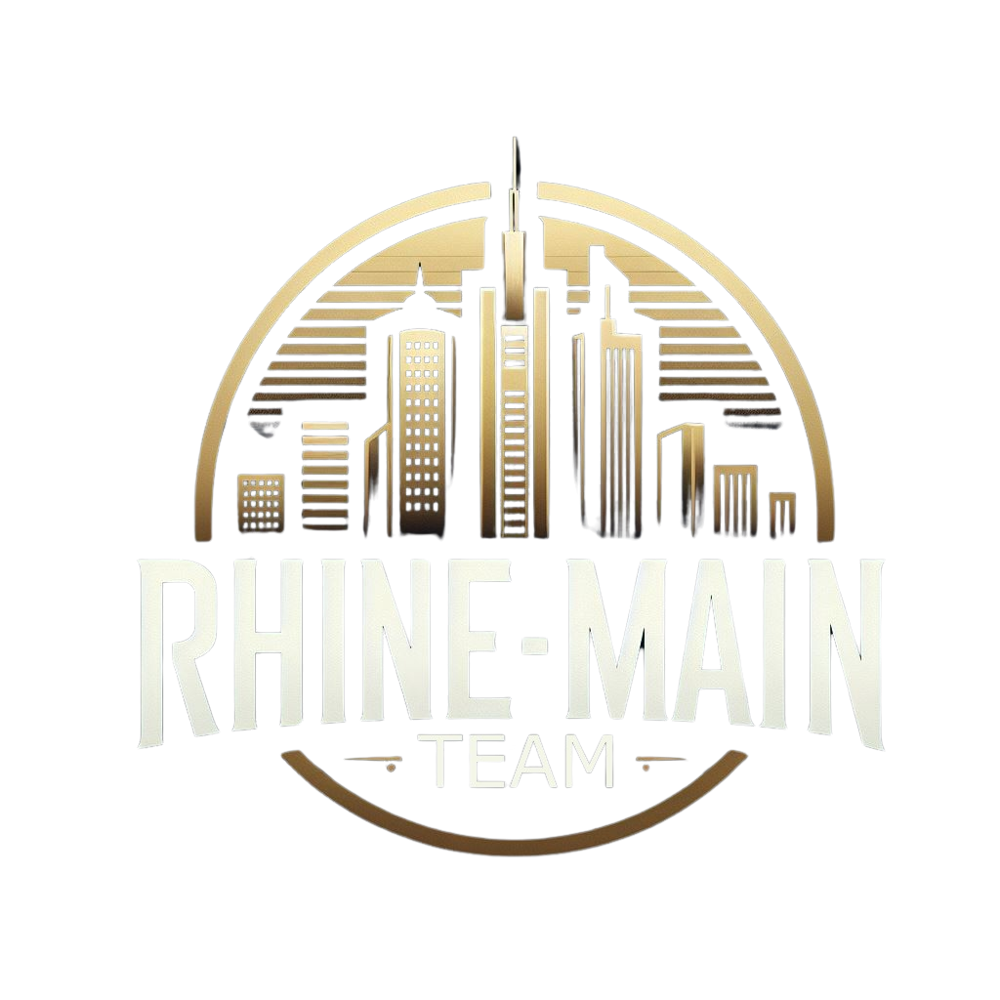
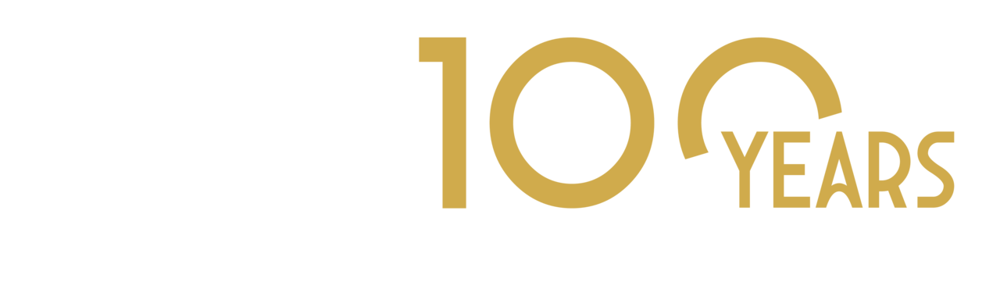

## „Frag doch den Agenten!"

Wie agentische KI unseren Embedded-Entwicklungsalltag verändert hat

ESE Kongress 2026 in Sindelfingen <!-- .element: class="ese-event" -->

Note:

Karsten: Hallo und herzlich willkommen zu „Frag doch den Agenten!“.

Judith: Schön, dass ihr da seid.

Karsten: Bevor es weitergeht, müssen wir noch schnell eine Story für unser Produkt SPLed
umsetzen.

(Karsten: nächste Folie)
