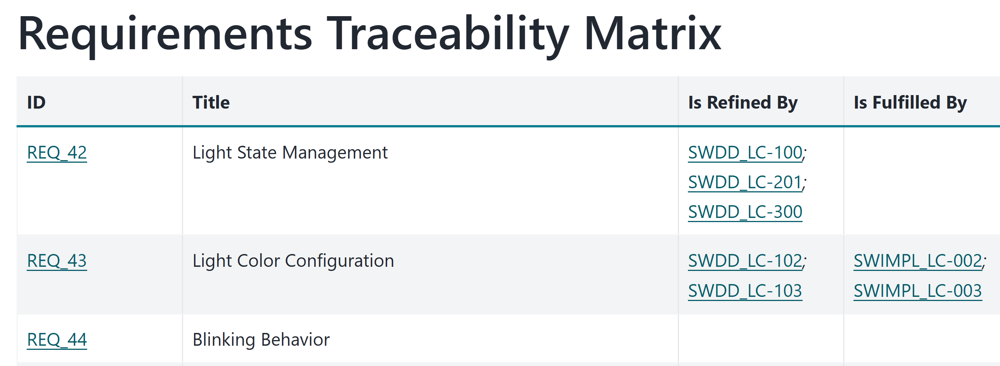
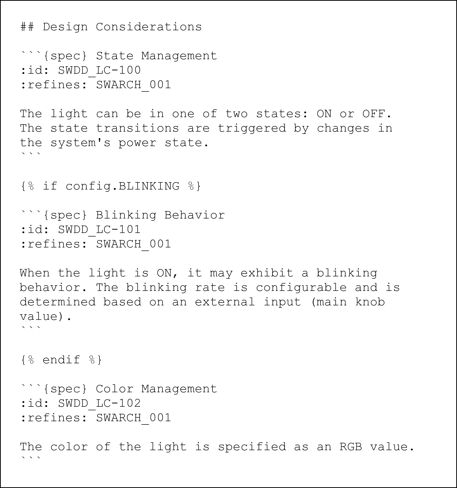
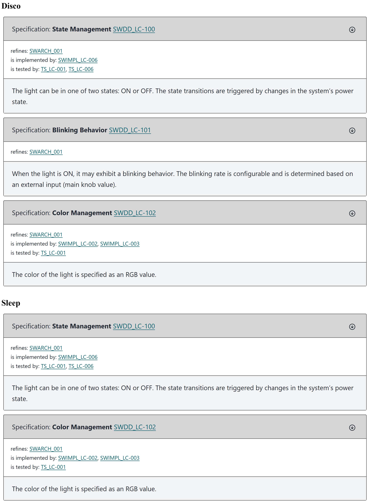

# Beyond Software: The Rise of “Engineering as Code” in Embedded Systems

How requirements, architecture, design and tests become one traceable repository

Akshit Kobagapu, Judith Reichwein, Marquardt GmbH

<!-- The proceedings article for this talk, in English.
     The organizer's rules are in AGENTS.md, section "The articles".
     American English throughout, matching the en-US stamp of the Word file.
     Draft of 2026-10-01. scripts/make_docx.py makes the Word file; Figure 1 becomes
     an image there. Figure 2 is a screenshot of a generated component report. -->

An embedded team keeps its source code in a repository. The engineering artifacts around it tend to live somewhere else. Requirements sit in one tool, the architecture in a second, the detailed design in a third, the test results in a fourth. Each tool is good at its job, and the chain between them is held together by people. In this article we describe how we moved those artifacts into the repository, as text, next to the code they describe. We show how the build resolves the links between them, how one feature model serves many product variants, and why this turns out to be the ground an AI agent needs.

## Between the tools

Between a new requirement and tested code there are typically more than one system and each owned by a different part of the organization. How well they serve their users varies a great deal. Some teams open a requirement in a second, others wait; some receive an architecture as a live model, others as a picture. That friction is worth fixing, but it is not our argument, because the problem we want to describe is the one that remains after every tool has been chosen well.

At each boundary the information is copied. A copy is accurate on the day it is made, and from then on it is a claim about a document somebody else owns. The developer works against the design they were given, not against the design as it stands today. The tester works against the specification they were given. Each handoff is sound in itself, and none of them is checked again afterwards.

Consistency across the whole chain is therefore a periodic human activity, often a spreadsheet filled in before a review or an audit. It is correct at the moment it is assembled. When a requirement changes afterwards and the design does not follow, nothing brings the two together. The build passes, the tests pass, and the spreadsheet stays green, because the requirement and the design are reviewed by different people in different systems and nobody sees both changes at once. The defect lives in the relationship between two documents, and no tool in the chain owns that relationship.

## What Engineering as Code means

If no tool owns the relationship between two documents, the relationship has to become something a tool can own. That is the whole idea. We move the engineering artifacts into the repository, beside the code they describe, and we write the links between them in a form the build can read. The name follows infrastructure as code and documentation as code, which made the same move for servers and for manuals.

In practice it means three things. The artifacts are text, so they are versioned, diffed and reviewed like code. Each one carries an identifier and names what it depends on, so a link is data rather than a sentence somebody has to notice. And the build resolves those links, so the evidence comes out of the command that compiles the software, every time, instead of out of a person before a review.

This is not the same as keeping documentation in the repository, which many teams already do. A design document can state in its own text that it implements requirement 43, and a person who reads that sentence learns something. The build learns nothing, because a sentence is prose. Written instead as a named link, the same fact becomes a question anyone can ask of the whole repository, and the useful questions are the ones nobody can answer by reading: which requirements have no test, which specifications nothing implements, which results belong to this variant and not that one.

## One repository, one chain

In SPLed [1], a small product line that builds a configurable light, the engineering artifacts live in the repository beside the code they describe.

```text
SPLed/
├── doc/                        product-level artifacts
│   ├── customer_requirements/  what the customer asked
│   ├── sw_requirements/        imported from RM system
│   ├── software_architecture/  the component structure
│   └── results/                the traceability matrix
├── components/
│   └── light_controller/       example component
│       ├── src/                the implementation
│       ├── test/               the unit tests
│       └── doc/                the detailed design
└── variants/
    ├── Disco/config.txt        the feature selection
    └── Sleep/config.txt
```

Figure 1: The layout of the repository. Requirements, architecture and the traceability matrix sit at the top; each component carries its own sources, tests and design; each variant is a feature selection. Source: SPLed [1], MIT license.

Every component is a folder with three parts: src, test and doc. The doc part is not a write-up produced after the work. It holds the detailed design, split into separate specifications, each with its own identifier, and it is built along with the software.

The three parts are held together by one rule: every artifact names what justifies it, and nothing names what follows from it. A specification refines the architecture. An implementation names the specification it implements and the requirement it fulfills. A test names the specification it verifies. Keeping that direction consistent is what lets a test be added without touching anything above it.

```text
doc/index.md
    {spec} Color Management
    :id: SWDD_LC-102
    :refines: SWARCH_001, REQ_43

src/light_controller.c
    .. impl:: Turn light on
       :id: SWIMPL_LC-003
       :implements: SWDD_LC-102
       :fulfills: REQ_43

test/test_light_controller.cc
    .. test:: light_controller.test_light_on_and_off
       :id: TS_LC-001
       :tests: SWDD_LC-100, SWDD_LC-102, SWDD_LC-300
```

Figure 2: The same specification seen from three sides, one excerpt from each part of the component folder. Each names only what is above it. Source: SPLed [1], MIT license.

Those identifiers are data rather than sentences, so the build can follow them. It produces a component report with requirements coverage, code coverage, and the path from a requirement to the test result that proves it, from the same command that compiles the software. We use spl-core [2] and Sphinx-Needs [3] for this. What matters is not the choice of tools but that the artifacts are text and the links are data. A developer runs the same command on their own machine, so the report exists before the change is pushed.

<!-- Figure 3: the Requirements Traceability Matrix of the generated report, Sleep
     variant, built from the public SPLed repository and screenshotted from the local
     build output with Edge headless at device scale factor 3 in the light theme,
     cropped to the header and three requirements; the rows between were removed.
     2660 px wide at 300 dpi. -->



Figure 3: Three rows of the traceability matrix of the generated report, Sleep variant. REQ_43 carries the specifications and implementations of Figure 2. REQ_44, the blinking behavior, has no entries because Sleep does not select that feature. Nobody assembled this table. Source: SPLed [1], MIT license.

When a requirement changes, the reviewer sees in the same pull request whether the design and the tests changed with it. A change that leaves the design behind is visible before it is merged, not months later in an audit.

Today the build resolves the links and warns. It does not refuse to finish when a link is missing. That is the next step.

## One source, many variants

A product line has a problem the single product does not: the same component behaves differently in each variant. That leaves two bad options, a document per variant or one document that describes all of them and matches none.

We take a third. The design document carries the same feature conditions as the code. A specification that belongs to an optional feature is wrapped in a condition on that feature, and so is the test that verifies it. When the report is generated for one variant, the feature selection resolves the documents as well as the sources, and the reader sees the specifications and test results of that product and nothing else.

Blinking shows it end to end. It is one symbol in the feature model, and every variant answers it.

```text
KConfig
    config BLINKING
        bool "Blinking Feature"
        default n

variants/Disco/config.txt
    CONFIG_BLINKING=y

variants/Sleep/config.txt
    # CONFIG_BLINKING is not set
```

Figure 4: The blinking feature in the feature model, selected by Disco and left out by Sleep. The same symbol guards the implementation in Figure 2 and the specification that describes it. Source: SPLed [1], MIT license.



Figure 5: The design document of the Light Controller. Three specifications are written once, and the middle one stands inside a condition on the blinking feature. Long lines are wrapped for print. Source: SPLed [1], MIT license.



Figure 6: What the build makes of Figure 5. The three specifications written once become three in Disco, which selects the blinking feature, and two in Sleep, which does not. The variant names were added as labels. Source: SPLed [1], MIT license.

One source, one feature model, a correct traceability matrix per variant, and no document maintained twice.

## The top of the chain

In most cases there is a point where the whole chain cannot live in one repository. System requirements are the clearest example: once hardware is in scope they cover more than software. Requirements like these are usually maintained in a requirements management system.

For new requirements we suggest writing them as documents in the repository. We do not suggest rewriting every existing requirement that way. Instead we built a process around the export the tool already offers: it produces CSV or ReqIF [4], we convert that into JSON, and the result is imported and traced in our reports like everything else. The same process works for any artifact that is maintained outside the repository.

The import is a copy as well, with the weakness we described above: it is accurate on the day of the export. The requirements tool is too slow to run in every build, so the export cannot simply become part of it. We are still working on a good way to keep it current.

## Why this suits an AI agent

This benefit was not the reason we started, and it has become the most visible one. An AI agent working on a change needs to know what the change must satisfy. When the artifacts live in four systems behind four logins, the agent sees the code and guesses the rest. When they live in one repository, it reads all of them.

We go one step further and give the agent skills: short written instructions describing how an artifact is written here, which identifier scheme it uses and which links it must carry. The agent then produces a specification, a test and an implementation in the shape the traceability needs, rather than prose a human has to rework. Its specifications, tests and links then go through the same build as a human's, with the same report and the same warnings.

## Summary

Moving the engineering artifacts into the repository changed three things for us. The chain from requirement to test result is resolved by the build and shown in a report, instead of assembled by hand. Every developer generates the full evidence locally, before pushing. And one feature model resolves the documents as well as the code, so each variant has its own correct report from a single source.

None of it depends on our particular tools. It depends on treating an engineering artifact as something with an identifier and a link, rather than as a document. The honesty of the chain stops being a matter of discipline and becomes a property of the repository.

## References

[1] SPLed, the demonstrator product line: https://github.com/avengineers/SPLed

[2] spl-core, the build framework behind it: https://github.com/avengineers/spl-core

[3] Sphinx-Needs, the traceability extension: https://sphinx-needs.readthedocs.io/

[4] ReqIF, the requirements interchange format: https://www.omg.org/spec/ReqIF/

## The authors

Akshit is a software engineer with more than 10 years of experience in the automotive industry. His work spans embedded software development, build systems and continuous integration, and the tooling that carries a change from a developer's machine to a released product. He brings that experience to the Rhine-Main Team (RMT) of Marquardt GmbH as an Advanced Software Development Engineer, where he concentrates on software product line engineering, CI/CD and traceable engineering artifacts.

Judith is a software engineer with more than 14 years of experience in the automotive industry. Her career covers almost the whole V-model, from requirements engineering through software automation and verification, project coordination and unit testing of security components, to simulation. She brings that experience to the Rhine-Main Team (RMT) of Marquardt GmbH as a Senior Software Engineer, where she concentrates on CI/CD, test automation and software product line engineering.
