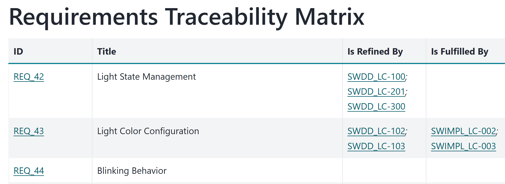
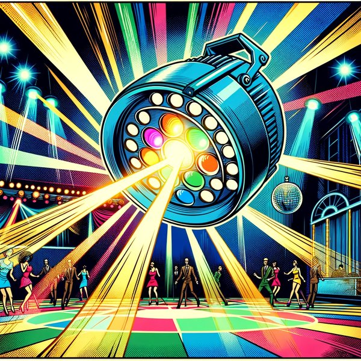
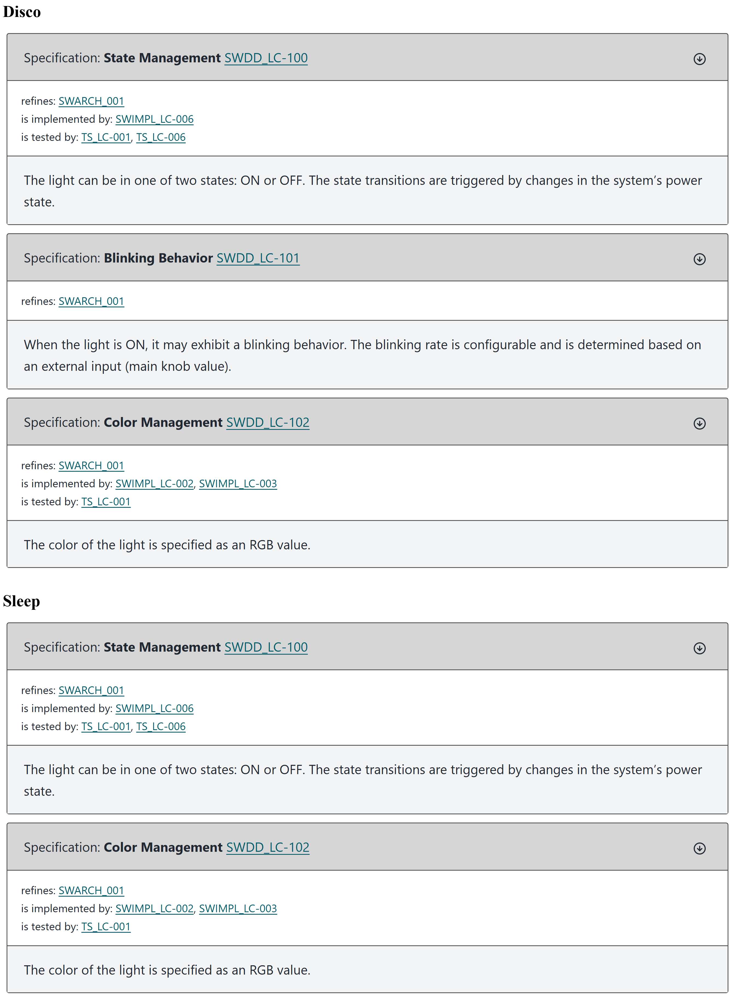

## Beyond Software

The Rise of "Engineering as Code" in Embedded Systems

<hr>

ESE Kongress 2026 in Sindelfingen <!-- .element: class="ese-event" -->

<div class="ese-logos">


</div>

Note:

Welcome the audience. Say the title of the talk.

---

### Who are we?

<div class="speakers">
<div class="speaker">


[Akshit](https://www.linkedin.com/in/akshit-kobagapu/)

</div>
<div class="speaker">


[Judith](https://www.linkedin.com/in/judith-reichwein-873665258/)

</div>
</div>

Note:

Each speaker says who they are in one or two sentences.

---

### Agenda

<div class="toc">

- Between the tools <!-- .element: class="fragment custom now" -->
- Engineering as Code
- One repository, one chain
- One source, many variants
- The top of the chain
- Why this suits an AI agent

</div>

Note:

About 30 seconds. We start with the problem: the chain between the tools. Then the idea of Engineering as Code, and how it looks in SPLed, our demonstrator: one repository and one chain from the requirement to the test result. Then how one source serves many variants, and what happens with requirements that live outside the repository. At the end: why all of this suits an AI agent.

Click: the first part, between the tools. The agenda comes back before each part.

---

### Between the tools

<div class="chain">
<div class="box"><b>Requirements</b>requirements tool<span class="who">requirements engineer</span></div>
<div class="arrow fragment" data-fragment-index="1">→</div>
<div class="box fragment" data-fragment-index="1"><b>Architecture</b>modeling tool<span class="who">architect</span></div>
<div class="arrow fragment" data-fragment-index="2">→</div>
<div class="box fragment" data-fragment-index="2"><b>Design</b>document<span class="who">designer</span></div>
<div class="arrow fragment" data-fragment-index="3">→</div>
<div class="box fragment" data-fragment-index="3"><b>Code</b>repository<span class="who">developer</span></div>
<div class="arrow fragment" data-fragment-index="4">→</div>
<div class="box fragment" data-fragment-index="4"><b>Tests</b>test tool<span class="who">tester</span></div>
<div class="arrow fragment" data-fragment-index="5">→</div>
<div class="box fragment" data-fragment-index="5"><b>Traceability</b>spreadsheet<span class="who">someone, before the audit</span></div>
</div>

Each tool is good at its job. People hold the chain together. <!-- .element: class="fragment" data-fragment-index="6" -->

Note:

Part 1, the problem, about 4 minutes for two slides.

Walk through the daily life of a developer, one click per box. The customer requirements sit in a tool that needs a license and an approval, and it is slow: you click a requirement today and read it tomorrow. The architecture lives in a second tool, and its pictures are copied into discussions. The design goes from the architect to the developer. The developer has no way to test against the requirements. The tester uses another tool, and the results cannot be traced back to the code. At the end, a person collects everything into a spreadsheet and says whether it is okay.

None of these tools is bad. The chain between them is the problem.

---

### A requirement changes

<div class="chain">
<div class="box fragment custom to-changed" data-fragment-index="1"><b>Requirements</b><span class="status"><span class="old">v1</span><span class="new">v2</span></span></div>
<div class="arrow">→</div>
<div class="box fragment custom to-changed" data-fragment-index="2"><b>Architecture</b><span class="status"><span class="old">v1</span><span class="new">v2</span></span></div>
<div class="arrow">→</div>
<div class="box fragment custom to-stale" data-fragment-index="4"><b>Design</b><span class="status">v1</span></div>
<div class="arrow fragment custom to-stale cross" data-fragment-index="4">→</div>
<div class="box fragment custom to-changed" data-fragment-index="3"><b>Code</b><span class="status"><span class="old">v1</span><span class="new">v2</span></span><span class="status ok">build ✓</span></div>
<div class="arrow">→</div>
<div class="box fragment custom to-changed" data-fragment-index="3"><b>Tests</b><span class="status"><span class="old">v1</span><span class="new">v2</span></span><span class="status ok">pass ✓</span></div>
<div class="arrow">→</div>
<div class="box"><b>Traceability</b><span class="status ok">green ✓</span></div>
</div>

Every handoff is a copy. <!-- .element: class="fragment statement" data-fragment-index="5" -->

The defect lives between two documents. <!-- .element: class="fragment statement" data-fragment-index="6" -->

No tool owns that relationship. <!-- .element: class="fragment statement" data-fragment-index="7" -->

Note:

Tell the change as a story, one click per step. At the start, everything is v1 and in sync. Click 1: the requirement changes to v2. Click 2: the architecture follows. Click 3: the developer changes the code and the tests. Click 4: nobody updates the design, so the design no longer matches the code. The tests pass and the traceability stays green the whole time.

At each boundary the information is copied. A copy is correct on the day it is made. After that, it is a claim about someone else's document. The developer works against the design they were given, not the design as it is today. Each handoff is sound in itself, and none of them is checked again afterwards.

A requirement changes after the design is done. The design does not follow. The build passes, the tests pass, and the spreadsheet stays green. The requirement and the design are reviewed by different people in different systems, and nobody sees both changes at once.

Pause after "No tool owns that relationship". This is the problem the rest of the talk solves.

---

### Agenda

<div class="toc at">

- Between the tools
- Engineering as Code <!-- .element: class="now" -->
- One repository, one chain
- One source, many variants
- The top of the chain
- Why this suits an AI agent

</div>

Note:

Next: Engineering as Code.

---

### Engineering as Code

All engineering artifacts live in the repository, beside the code. <!-- .element: class="small" -->

- Artifacts are text <!-- .element: class="fragment" -->
- Links are data <!-- .element: class="fragment" -->
- The build resolves the links <!-- .element: class="fragment" -->

Note:

Part 2, the idea, about 3 minutes for two slides.

If no tool owns the relationship between two documents, the relationship has to become something a tool can own. That is the whole idea. We move the engineering artifacts into the repository, beside the code they describe. The name follows infrastructure as code and documentation as code, which made the same move for servers and for manuals.

In practice it means three things. The artifacts are text, so they are versioned, diffed and reviewed like code. Each artifact has an identifier and names what it depends on, so a link is data and not a sentence somebody has to notice. And the build resolves the links, so the evidence comes out of the command that compiles the software. The third one is the important one: the evidence comes out of the build, every time, and not out of a person before a review.

---

### A sentence is not a link

<div class="versus">
<div class="box">
<b>Prose</b>
<p>"This design implements requirement 43."</p>
<p class="caption">A reader learns something.</p>
</div>
<div class="box fragment">
<b>Data</b>
<pre><code class="plaintext">:id: SWDD_LC-102
:refines: REQ_43</code></pre>
<p class="caption">The build learns something.</p>
</div>
</div>

Note:

Many teams keep documentation in the repository already. That is not the same thing. A design document can say in its own text that it implements requirement 43. A person who reads the sentence learns something. The build learns nothing, because a sentence is prose. Written as a named link, the same fact becomes a question anyone can ask of the whole repository.

The useful questions are the ones nobody can answer by reading:

- Which requirements have no test?
- Which specifications does nothing implement?
- Which results belong to this variant and not to that one?

With links as data, the build answers these questions for the whole repository, every time.

---

### Agenda

<div class="toc at">

- Between the tools
- Engineering as Code
- One repository, one chain <!-- .element: class="now" -->
- One source, many variants
- The top of the chain
- Why this suits an AI agent

</div>

Note:

Next: one repository, one chain. We show it in SPLed.

---

### Meet SPLed

Software Product Line Engineering Demonstrator <!-- .element: class="small" -->

 <!-- .element: class="logo" -->

<p class="small">Open source, MIT license: <a href="https://github.com/avengineers/SPLed">github.com/avengineers/SPLed</a></p>

Note:

Part 3, one repository, one chain, about 7 minutes for six slides.

SPLed is our Software Product Line Engineering Demonstrator, and it is open source under the MIT license: a product line of lights with three products, the Sleeping Light, the Disco Light and the Spa Light. One repository, three products. Nobody forked anything to get the third one. We meet the three products again when we come to variants.

SPLed is more than a demo of how this works. It shows how our software developers work every day. And it is the basis for the development of our SPLE Platform: every new feature of the platform is tested in SPLed first.

---

### One repository

```plaintext
SPLed/
├── doc/                        product-level artifacts
│   ├── customer_requirements/  what the customer wants
│   ├── sw_requirements/        from a requirements tool
│   ├── software_architecture/  the component structure
│   └── results/                the traceability matrix
├── components/
│   └── light_controller/       example component
│       ├── src/                the implementation
│       ├── test/               the unit tests
│       └── doc/                the detailed design
└── variants/
    ├── Disco/config.txt        the feature selection
    └── Sleep/config.txt
```

Note:

Product-level artifacts at the top, a folder per component, a feature selection per variant.

Every component has three parts: src, test and doc. The doc part is not a write-up after the work. It holds the detailed design, split into separate specifications, each with its own identifier. It is built along with the software.

---

### Name what justifies you

<div class="two-cols">
<div class="links">
<svg width="540" height="468" viewBox="0 0 540 468">
<defs>
<marker id="link-arrow" viewBox="0 0 10 10" refX="9" refY="5" markerWidth="7" markerHeight="7" orient="auto"><path d="M0,0 L10,5 L0,10 z"/></marker>
<marker id="link-arrow-now" viewBox="0 0 10 10" refX="9" refY="5" markerWidth="7" markerHeight="7" orient="auto"><path d="M0,0 L10,5 L0,10 z"/></marker>
</defs>
<line class="fragment custom" data-fragment-index="2" x1="340" y1="34" x2="200" y2="34"/>
<line class="fragment custom" data-fragment-index="3" x1="230" y1="140" x2="130" y2="68"/>
<line class="fragment custom" data-fragment-index="3" x1="310" y1="140" x2="410" y2="68"/>
<line class="fragment custom" data-fragment-index="6" x1="130" y1="280" x2="230" y2="208"/>
<line class="fragment custom" data-fragment-index="6" x1="40" y1="280" x2="40" y2="68"/>
<line class="fragment custom" data-fragment-index="4" x1="410" y1="280" x2="310" y2="208"/>
<line class="fragment custom" data-fragment-index="5" x1="440" y1="400" x2="440" y2="348"/>
</svg>
<span class="label realizes fragment custom" data-fragment-index="2">realizes</span>
<span class="label refines-req fragment custom" data-fragment-index="3">refines</span>
<span class="label refines-arch fragment custom" data-fragment-index="3">refines</span>
<span class="label implements fragment custom" data-fragment-index="6">implements</span>
<span class="label fulfills fragment custom" data-fragment-index="6">fulfills</span>
<span class="label tests fragment custom" data-fragment-index="4">tests</span>
<span class="label result-of fragment custom" data-fragment-index="5">linked by the build</span>
<div class="box req fragment custom" data-fragment-index="1"><b>Requirement</b><code>REQ_43</code></div>
<div class="box arch fragment custom" data-fragment-index="2"><b>Architecture</b><code>SWARCH_001</code></div>
<div class="box spec fragment custom" data-fragment-index="3"><b>Specification</b><code>SWDD_LC-102</code></div>
<div class="box test fragment custom" data-fragment-index="4"><b>Test</b><code>TS_LC-001</code></div>
<div class="box result fragment custom" data-fragment-index="5"><b>Test result</b><span class="fragment custom flip" data-fragment-index="7"><span class="before stale">fails ✗</span><span class="after ok">passes ✓</span></span></div>
<div class="box impl fragment custom" data-fragment-index="6"><b>Implementation</b><code>SWIMPL_LC-003</code></div>
</div>
<div class="small">

Every artifact names what justifies it. <!-- .element: class="fragment" data-fragment-index="8" -->

Nothing names what follows from it. <!-- .element: class="fragment" data-fragment-index="9" -->

A new test changes nothing above it. <!-- .element: class="fragment" data-fragment-index="10" -->

</div>
</div>

Note:

Walk through the development lifecycle, test first, one click per step. Click 1: the requirement comes first. Click 2: the architecture realizes it. Click 3: the specification refines the requirement and the architecture. Click 4: the developer writes the test for the specification, before any code. Click 5: the build runs the test, links the result to it, and the test fails, because nothing implements the specification yet. Click 6: the developer writes the implementation, which implements the specification and fulfills the requirement. Click 7: the build runs the test again, and it passes.

One rule holds the three parts together. The architecture realizes the requirement. A specification refines the architecture and the requirement. An implementation names the specification it implements and the requirement it fulfills. A test names the specification it verifies. All links point upwards. That is why we can add a test without touching anything above it.

The chain ends at the test result. Nobody writes that link: the build runs the test, and spl-core links each result to its test by the name of the test.

---

### One specification, three files

```plaintext [1-4|6-10|12-15]
doc/index.md
    {spec} Color Management
    :id: SWDD_LC-102
    :refines: SWARCH_001, REQ_43

src/light_controller.c
    .. impl:: Turn light on
       :id: SWIMPL_LC-003
       :implements: SWDD_LC-102
       :fulfills: REQ_43

test/test_light_controller.cc
    .. test:: light_controller.test_light_on_and_off
       :id: TS_LC-001
       :tests: SWDD_LC-100, SWDD_LC-102, SWDD_LC-300
```
<!-- .element: class="no-numbers" -->

Note:

The same specification from three sides, one excerpt from each part of the component folder. In the C and C++ files, the entries sit in comments. Each one names only what is above it.

---

### Nobody assembled this table

 <!-- .element: class="shot" -->

Three rows of the traceability matrix, Sleep variant <!-- .element: class="caption" -->

Note:

The identifiers are data, so the build can follow them. One build reads the source code, the tests, the design documents and the variant configuration. It produces the software, the test results and a report with the traceability. The report shows the path from each requirement to the tests that verify it, and it comes from the same command that compiles the software. We use spl-core and Sphinx-Needs for this.

This table is part of that report. REQ_43 carries the specification and the implementation from the previous slides. REQ_44, the blinking behavior, has no entries: Sleep does not select that feature. Nobody filled in this table. The build made it.

The same command runs on every developer's machine. So the report exists before the push, not only on the build server.

---

### The review sees the whole change

<div class="pr">
<div class="pr-head">Pull request: 4 files changed</div>
<div class="file"><div><b>Requirement</b> <code>REQ_43</code><span class="path">doc/ubconnect/sw_requirements.json</span></div><span class="state changed">changed</span></div>
<div class="file"><div><b>Design</b> <code>SWDD_LC-102</code><span class="path">components/light_controller/doc/index.md</span></div><span class="state changed">changed</span></div>
<div class="file"><div><b>Code</b> <code>SWIMPL_LC-003</code><span class="path">components/light_controller/src/light_controller.c</span></div><span class="state changed">changed</span></div>
<div class="file"><div><b>Test</b> <code>TS_LC-001</code><span class="path">components/light_controller/test/test_light_controller.cc</span></div><span class="state changed">changed</span></div>
</div>

The reviewer sees the whole chain before the merge. <!-- .element: class="fragment small" -->

Note:

This is the answer to the problem slide. The same change as before: the requirement changes, and the design, the code and the test change with it. All of it is in one pull request. The reviewer sees the whole chain at once, before the merge, not months later in an audit.

Be honest about the state: today the build resolves the links and warns on a missing link. It does not refuse to finish when a link is missing. That is our next step.

---

### Agenda

<div class="toc at">

- Between the tools
- Engineering as Code
- One repository, one chain
- One source, many variants <!-- .element: class="now" -->
- The top of the chain
- Why this suits an AI agent

</div>

Note:

Next: one source, many variants.

---

### One component, many variants

The same component behaves differently in each variant. <!-- .element: class="small" -->

<div class="lights">
<div class="fragment">


<p class="caption">Sleep<span class="feature">no blinking</span></p>

</div>
<div class="fragment">



<p class="caption">Disco<span class="feature">blinking</span></p>

</div>
<div class="fragment">


<p class="caption">Spa<span class="feature">no blinking</span></p>

</div>
</div>

The documents carry the same feature conditions as the code. <!-- .element: class="fragment small" -->

Note:

Part 4, variants, about 5 minutes for four slides.

The three products of SPLed share the light controller, but it behaves differently in each of them: Disco blinks, Sleep and Spa do not. A product line has a problem a single product does not have. There are two bad options: a document per variant, or one document for all variants that matches none. We take a third: a specification that belongs to an optional feature is wrapped in a condition on that feature, and so is the test that verifies it.

---

### The feature model

```plaintext
KConfig
    config BLINKING
        bool "Blinking Feature"
        default n

variants/Disco/config.txt
    CONFIG_BLINKING=y

variants/Sleep/config.txt
    # CONFIG_BLINKING is not set

variants/Spa/config.txt
    # CONFIG_BLINKING is not set
```

Note:

Blinking shows it end to end. The feature model has the blinking feature. Disco selects it, Sleep and Spa leave it out.

---

### A condition in the design

````plaintext [1-8|9-18]
```{spec} State Management
:id: SWDD_LC-100
:refines: SWARCH_001, REQ_42

The light can be in one of two states: ON or OFF. The
state transitions are triggered by changes in the
system's power state.
```

```{spec} Blinking Behavior
:id: SWDD_LC-101
:refines: SWARCH_001, REQ_44

When the light is ON, it may exhibit a blinking behavior.
The blinking rate is configurable and is determined based
on an external input (main knob value).
```

````
<!-- .element: class="tall" -->

Note:

Two specifications from the design document of the Light Controller. The first one is in every variant. The second one depends on the blinking feature, with the same condition as the code.

---

### One report per variant

 <!-- .element: class="shot" -->

One source, one feature model, a correct report per variant. No document maintained twice. <!-- .element: class="fragment caption" -->

Note:

The report for Disco has both specifications. The report for Sleep has only the first one. The reader sees the specifications and test results of their product and nothing else.

---

### Agenda

<div class="toc at">

- Between the tools
- Engineering as Code
- One repository, one chain
- One source, many variants
- The top of the chain <!-- .element: class="now" -->
- Why this suits an AI agent

</div>

Note:

Next: the top of the chain, the requirements that live outside the repository.

---

### The top of the chain

<div class="chain spaced">
<div class="box"><b>Requirements tool</b></div>
<div class="arrow">→</div>
<div class="box"><b>Export</b>CSV or ReqIF</div>
<div class="arrow">→</div>
<div class="box"><b>Convert</b>JSON</div>
<div class="arrow">→</div>
<div class="box"><b>Report</b>traced like everything else</div>
</div>

- New requirements: write them in the repository <!-- .element: class="fragment" -->
- Existing requirements: import the export <!-- .element: class="fragment" -->
- The import is a copy too. Keeping it current is still open. <!-- .element: class="fragment" -->

Note:

Part 5, about 2 minutes.

Not everything fits in one repository. System requirements are the clearest example: once hardware is in scope, they cover more than software, and they live in a requirements management tool.

We do not rewrite every existing requirement. We take the export the tool already offers, CSV or ReqIF, convert it into JSON, and trace it like everything else. The same process works for any artifact that lives outside the repository.

The weakness: the import is accurate on the day of the export. The requirements tool is too slow to run in every build. We are still working on this.

---

### Agenda

<div class="toc at">

- Between the tools
- Engineering as Code
- One repository, one chain
- One source, many variants
- The top of the chain
- Why this suits an AI agent <!-- .element: class="now" -->

</div>

Note:

Next: why all of this suits an AI agent.

---

### What if the design is left behind?

<div class="pr">
<div class="pr-head">Pull request: 3 files changed</div>
<div class="file"><div><b>Requirement</b> <code>REQ_43</code><span class="path">doc/ubconnect/sw_requirements.json</span></div><span class="state changed">changed</span></div>
<div class="file missing fragment" data-fragment-index="1"><div><b>Design</b> <code>SWDD_LC-102</code><span class="path">components/light_controller/doc/index.md</span></div><span class="state">not in this pull request</span></div>
<div class="file"><div><b>Code</b> <code>SWIMPL_LC-003</code><span class="path">components/light_controller/src/light_controller.c</span></div><span class="state changed">changed</span></div>
<div class="file"><div><b>Test</b> <code>TS_LC-001</code><span class="path">components/light_controller/test/test_light_controller.cc</span></div><span class="state changed">changed</span></div>
</div>

The links still resolve. The build sees nothing wrong. <!-- .element: class="fragment small" data-fragment-index="2" -->

Note:

Part 6, AI, about 5 minutes for four slides.

Back to the pull request from before, with one difference. Click 1: the design is not in the pull request. The requirement, the code and the test changed, the design did not.

Click 2: the links still resolve, so the build sees nothing wrong. Only a reviewer who knows the structure notices that a file is missing. This is where an AI agent helps.

---

### Why this suits an AI agent

<div class="agent-view">
<div class="box folder">
<div class="head">components/light_controller/</div>
<div class="item"><code>doc/</code><span>Specification <code>SWDD_LC-102</code></span></div>
<div class="item"><code>src/</code><span>Implementation <code>SWIMPL_LC-003</code></span></div>
<div class="item"><code>test/</code><span>Test <code>TS_LC-001</code></span></div>
</div>
<div class="flow">
<span class="fragment">reads the structure →</span>
<span class="fragment">← writes in the same shape</span>
</div>
<div class="box agent"><b>AI agent</b></div>
</div>

A folder per component. One rule for links. <!-- .element: class="small" -->

Note:

This benefit came as a surprise. It was not the reason we started. Everything is in one place, so the agent can read the whole repository.

Click 1: the agent reads the structure: a folder per component with src, test and doc, and the rule that every artifact names what justifies it. Click 2: it makes its changes in that same structure.

---

### Skills: our rules, written down

<div class="skill-shape">
<div class="label-top">The rule in the skill <code>c-unit-testing</code></div>
<pre><code class="plaintext"> * .. test:: &lt;Component&gt;.DescriptiveTestName
 *    :id: TS_&lt;COMP&gt;-001
 *    :tests: SWDD_&lt;COMP&gt;-100</code></pre>
<div class="fragment">
<div class="down">↓ same shape</div>
<div class="label-top">A test in SPLed</div>
<pre><code class="plaintext"> * .. test:: light_controller.test_light_on_and_off
 *    :id: TS_LC-001
 *    :tests: SWDD_LC-100, SWDD_LC-102, SWDD_LC-300</code></pre>
</div>
</div>

Same build, same report, same warnings. <!-- .element: class="fragment small" -->

Note:

A skill is a set of written instructions that the agent loads when a task needs it. Ours describe how an artifact is written here, which identifier scheme it uses and which links it must carry.

On top: a real excerpt from the unit test skill in sple-skills. It gives the agent the shape of a test entry, with its identifier and the specification it tests. Click 1: a test in SPLed has exactly that shape. So the agent writes a specification, a test and an implementation in the shape the traceability needs, not prose a human has to rework.

Click 2: the agent's work goes through the same build as a human's, with the same report and the same warnings. Our skills are public: sple-skills on GitHub.

---

### The agent as a reviewer

<div class="pr">
<div class="pr-head">Pull request: 3 files changed</div>
<div class="file"><div><b>Requirement</b> <code>REQ_43</code><span class="path">doc/ubconnect/sw_requirements.json</span></div><span class="state changed">changed</span></div>
<div class="file missing"><div><b>Design</b> <code>SWDD_LC-102</code><span class="path">components/light_controller/doc/index.md</span></div><span class="state">not in this pull request</span></div>
<div class="comment fragment"><div class="who">AI agent <span class="tag">(example)</span></div>REQ_43 changed, but SWDD_LC-102, which refines it, is not in this pull request. Please update the design or say why it still fits.</div>
<div class="file"><div><b>Code</b> <code>SWIMPL_LC-003</code><span class="path">components/light_controller/src/light_controller.c</span></div><span class="state changed">changed</span></div>
<div class="file"><div><b>Test</b> <code>TS_LC-001</code><span class="path">components/light_controller/test/test_light_controller.cc</span></div><span class="state changed">changed</span></div>
</div>

Note:

Back to the pull request where the design was left behind. The same knowledge that helps the agent write artifacts makes it a useful reviewer. It checks each change against the structure.

Click 1: it comments on the gap. REQ_43 changed, and the design that refines it did not. This comment is an example we wrote for the slide. It shows the kind of comment the agent gives. The same works for other gaps, for example a specification without a test.

Because the code, the specification and the test change together, one pull request holds the whole change. The agent and the human reviewer look at the same thing.

---

### It is not about our tools

An engineering artifact is something with an identifier and a link, not a document. <!-- .element: class="statement" -->

Then the chain is something the build can read. <!-- .element: class="fragment statement" -->

Note:

Summary, about 2 minutes for two slides.

Three things changed for us. The build resolves the chain from requirement to test result and shows it in a report, instead of a person assembling it by hand. Every developer makes the full evidence locally, before the push. And one feature model resolves the documents as well as the code, so each variant has its own correct report from a single source.

None of this depends on our particular tools. It depends on treating an artifact as something with an identifier and a link. The chain stops being a matter of discipline alone.

---

### Try it yourself

- [SPLed](https://github.com/avengineers/SPLed): the demonstrator product line
- [spl-core](https://github.com/avengineers/spl-core): the build framework
- [Sphinx-Needs](https://sphinx-needs.readthedocs.io/): the traceability extension
- [sple-skills](https://github.com/avengineers/sple-skills): our agent skills

Note:

Everything we showed is open source. Clone SPLed and run the build on your own machine.

---

### Questions?

<div class="qr">


</div>

https://avengineers.github.io/ESE-2026/docs/eng_as_code/ <!-- .element: class="deck-url" -->

---

### Some Links

- [We@GitHub](https://github.com/avengineers)
- [Printable Slides](https://avengineers.github.io/ESE-2026/docs/eng_as_code/?print-pdf)
