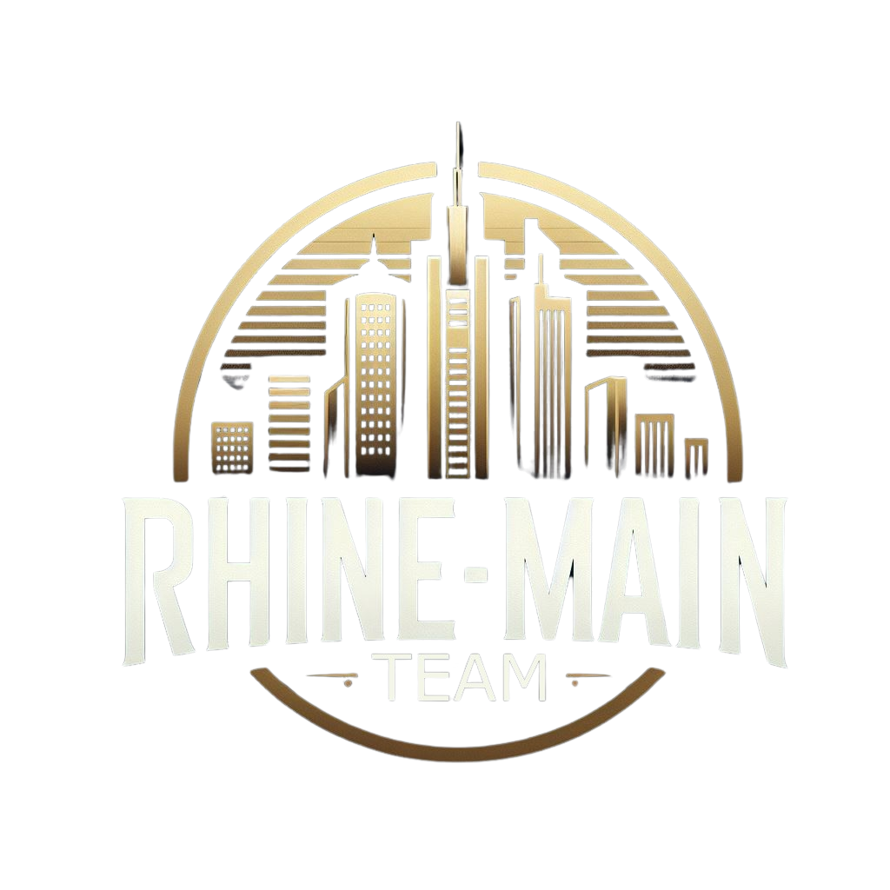
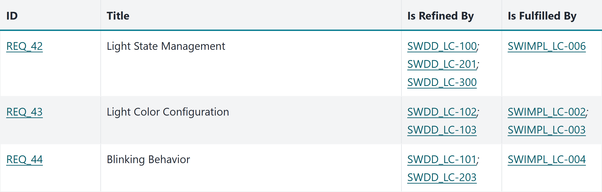

## Beyond Software

The Rise of "Engineering as Code" in Embedded Systems

<hr>

ESE Kongress 2026 in Sindelfingen <!-- .element: class="ese-event" -->

<div class="ese-logos">


</div>

<div hidden>
<span class="fragment" data-notes="Our talk: Beyond Software, the rise of Engineering as Code. [Click.]"></span>
<span class="fragment" data-notes="Imagine a customer changes a requirement. The code follows, the tests follow, but the design is left behind. How do we keep the chain from requirement to test intact? That is what this talk answers."></span>
</div>

Note:

[Text in square brackets is for you. Plain text is what you say. On this slide, clicks change only the notes.]

[Pause after "best for last".] Welcome. The organisers put us last. We choose to believe they saved the best for last. Please don't check that claim. We have no traceability for it. [Click.]

---

### Who are we?

<div class="speakers">
<div class="speaker">


[Akshit](https://www.linkedin.com/in/akshit-kobagapu/)

</div>
<div class="speaker">


[Judith](https://www.linkedin.com/in/judith-reichwein-873665258/)

</div>
</div>

<div hidden>
<span class="fragment" data-notes="Judith: I am Judith, a senior software engineer at Marquardt. I have worked in automotive for more than 14 years, across almost the whole V-model, from requirements to integration tests. [Click.]"></span>
<span class="fragment" data-notes="Today Akshit and I work in the same team, on CI/CD, test automation and product line engineering. We both maintain SPLed and spl-core. [Turn to Akshit.] Akshit, what can everyone here expect from us today? [Click.]"></span>
</div>

Note:

[Akshit. The click changes only the notes.]

I am Akshit, Advanced Software Development Engineer at Marquardt, with more than 10 years in automotive. I come from embedded software and build systems, with a focus on resources and timing: resource estimation, timing architecture and timing analysis. [Click.]

---

### Agenda

<div class="toc">

- Between the tools <!-- .element: class="fragment" data-notes="First, the problem: what happens between the tools." -->
- Engineering as Code <!-- .element: class="fragment" data-notes="Then the idea that fixes it: Engineering as Code." -->
- One repository, one chain <!-- .element: class="fragment" data-notes="We show how it looks in SPLed, our demonstrator: one repository, one chain from requirement to test result." -->
- One source, many variants <!-- .element: class="fragment" data-notes="Judith then shows how one source serves many variants." -->
- The top of the chain <!-- .element: class="fragment" data-notes="After that, the top of the chain: requirements that live in a requirements tool, outside the repository, and how we bring them in." -->
- Why this suits an AI agent <!-- .element: class="fragment" data-notes="And at the end, a bonus: why all of this suits an AI agent. [Next click: part 1.]" -->

</div>

Note:

[About 30 seconds. One click per point.]

Here is where we're going. [Click.]

---

### Between the tools

<div class="chain">
<div class="box"><b>Requirements</b>requirements tool<span class="who">requirements engineer</span></div>
<div class="arrow fragment" data-fragment-index="1" data-notes="From the requirements, the architect builds the architecture, in a second tool. Its pictures end up copied into discussions. [Click.]">→</div>
<div class="box fragment" data-fragment-index="1"><b>Architecture</b>modeling tool<span class="who">architect</span></div>
<div class="arrow fragment" data-fragment-index="2" data-notes="Then the design goes into a document and is handed over to the developer. [Click.]">→</div>
<div class="box fragment" data-fragment-index="2"><b>Design</b>document<span class="who">designer</span></div>
<div class="arrow fragment" data-fragment-index="3" data-notes="The developer writes the code. But there is no way to test it against the requirements. [Click.]">→</div>
<div class="box fragment" data-fragment-index="3"><b>Code</b>repository<span class="who">developer</span></div>
<div class="arrow fragment" data-fragment-index="4" data-notes="So the tester tests in yet another tool. And the results cannot be traced back to the code. [Click.]">→</div>
<div class="box fragment" data-fragment-index="4"><b>Tests</b>test tool<span class="who">tester</span></div>
<div class="arrow fragment" data-fragment-index="5" data-notes="And at the end, before the audit, someone collects everything into a spreadsheet and says: looks okay. [Hands up.] Who has filled in a traceability spreadsheet the week before an audit? [Pause.] Keep your hand up if you enjoyed it. [Click.]">→</div>
<div class="box fragment" data-fragment-index="5"><b>Traceability</b>spreadsheet<span class="who">someone, before the audit</span></div>
</div>

Each tool is good at its job. People hold the chain together. <!-- .element: class="fragment" data-fragment-index="6" data-notes="Each of these tools is good at its job. None of them is the problem. The problem is the chain between them. And today, people hold that chain together." -->

Note:

[Part 1, the problem: about 4 minutes, two slides. One click per box.]

Let's start where every project starts: with the requirements. They sit in a requirements tool. To read them, you need a license and an approval. And the tool is slow: you click a requirement today, and you read it tomorrow. [Click.]

---

### A requirement changes

<div class="chain">
<div class="box fragment custom to-changed" data-fragment-index="1" data-notes="A customer changes a requirement. It is now v2. [Click.]"><b>Requirements</b><span class="status"><span class="old">v1</span><span class="new">v2</span></span></div>
<div class="arrow">→</div>
<div class="box fragment custom to-changed" data-fragment-index="2" data-notes="The architect updates the architecture. Also v2. [Click.]"><b>Architecture</b><span class="status"><span class="old">v1</span><span class="new">v2</span></span></div>
<div class="arrow">→</div>
<div class="box fragment custom to-stale" data-fragment-index="4" data-notes="But nobody updates the design. It still says v1, and it no longer matches the code. And look: the traceability is still green. [Click.]"><b>Design</b><span class="status">v1</span></div>
<div class="arrow fragment custom to-stale cross" data-fragment-index="4">→</div>
<div class="box fragment custom to-changed" data-fragment-index="3" data-notes="The developer changes the code and the tests. The build passes, the tests pass. [Click.]"><b>Code</b><span class="status"><span class="old">v1</span><span class="new">v2</span></span><span class="status ok">build ✓</span></div>
<div class="arrow">→</div>
<div class="box fragment custom to-changed" data-fragment-index="3"><b>Tests</b><span class="status"><span class="old">v1</span><span class="new">v2</span></span><span class="status ok">pass ✓</span></div>
<div class="arrow">→</div>
<div class="box"><b>Traceability</b><span class="status ok">green ✓</span></div>
</div>

Every handoff is a copy. <!-- .element: class="fragment statement" data-fragment-index="5" data-notes="How can that happen? Every handoff is a copy. A copy is correct on the day it is made. After that, it is just a claim about someone else's document. The developer works against the design they were given, not the design as it is today. [Click.]" -->

The defect lives between two documents. <!-- .element: class="fragment statement" data-fragment-index="6" data-notes="So the defect lives between two documents. The requirement and the design are reviewed by different people, in different systems. Nobody sees both changes at once. [Click.]" -->

No tool owns that relationship. <!-- .element: class="fragment statement" data-fragment-index="7" data-notes="And no tool owns that relationship. [Pause.] This is the problem the rest of the talk solves." -->

Note:

[Tell it as a story, one click per step.]

Now let's see what happens when something changes. At the start, everything is v1 and in sync. [Click.]

---

### Agenda

<div class="toc at">

- Between the tools
- Engineering as Code <!-- .element: class="now" -->
- One repository, one chain
- One source, many variants
- The top of the chain
- Why this suits an AI agent

</div>

Note:

So what do we do about it? Engineering as Code.

---

### Engineering as Code

All engineering artifacts live in the repository, beside the code. <!-- .element: class="small" -->

<div hidden>
<span class="fragment" data-notes="We move the engineering artifacts into the repository, beside the code they describe. [Click.]"></span>
<span class="fragment" data-notes="The name comes from infrastructure as code and documentation as code: the same move, for servers and for manuals. In practice, that means three things. [Click.]"></span>
</div>

- Artifacts are text <!-- .element: class="fragment" data-notes="First: the artifacts are text. So they are versioned, diffed and reviewed like code. [Click.]" -->
- Links are data <!-- .element: class="fragment" data-notes="Second: links are data. Each artifact has an identifier and names what it depends on. A link is no longer a sentence somebody has to notice. [Click.]" -->
- The build resolves the links <!-- .element: class="fragment" data-notes="Third, and most important: the build resolves the links. The evidence comes out of the same command that compiles the software. Every time, not from a person before a review." -->

Note:

[Part 2, the idea: about 3 minutes, two slides. The first two clicks change only the notes.]

Our answer: if no tool owns the relationship, we make it something a tool can own. That is the whole idea. [Click.]

---

### A sentence is not a link

<div hidden>
<span class="fragment" data-notes="[If needed:
Teammate's hand up: That's my team. You don't count.
Other hands up: Great. Let's compare notes after the talk.
Many hands up: Then this slide is quick.
No hands: Then the next 10 minutes are for you.]
That is the difference. [Click.]"></span>
<span class="fragment" data-notes="[Point at the prose box.] Here a design document says in its text: this design implements requirement 43. A reader learns something. The build learns nothing, because a sentence is prose. [Click.]"></span>
</div>

<div class="versus">
<div class="box">
<b>Prose</b>
<p>"This design implements requirement 43."</p>
<p class="caption">A reader learns something.</p>
</div>
<div class="box fragment" data-notes="Now the same fact as data: a named link. Now the build learns something too. And we can ask questions nobody can answer by reading. Which requirements have no test? Which specifications does nothing implement? Which results belong to this variant? The build answers them for the whole repository, every time.">
<b>Data</b>
<pre><code class="plaintext">:id: SWDD_LC-102
:refines: REQ_43</code></pre>
<p class="caption">The build learns something.</p>
</div>
</div>

Note:

[Hands up. The first two clicks change only the notes.] Who keeps documentation in the repository already? [Pause.] Good. Now keep it up if your build can tell you which requirement has no test. [Click.]

---

### Agenda

<div class="toc at">

- Between the tools
- Engineering as Code
- One repository, one chain <!-- .element: class="now" -->
- One source, many variants
- The top of the chain
- Why this suits an AI agent

</div>

Note:

Now let's see it in practice: one repository, one chain. We show it in SPLed.

---

### Meet SPLed

Software Product Line Engineering Demonstrator <!-- .element: class="small" -->

 <!-- .element: class="logo" -->

<p class="small">Open source, MIT license: <a href="https://github.com/avengineers/SPLed">github.com/avengineers/SPLed</a></p>

<div hidden>
<span class="fragment" data-notes="SPLed is a product line of lights with three variants. All three live in one repository, with one chain from requirement to test result. That is what we show you next. [Click.]"></span>
<span class="fragment" data-notes="But it is more than a demo. It shows how our developers work every day. And every new feature of our SPLE Platform is tested in SPLed first. Everything on the next slides comes from SPLed. You will see the three lights again in Judith's part."></span>
</div>

Note:

[Part 3, one repository, one chain: about 7 minutes, six slides. Clicks change only the notes.]

To show you how this looks, meet SPLed, our Software Product Line Engineering Demonstrator. We built it for training, and it is open source. The link is on the slide: you can clone it and run the build yourself. [Click.]

---

### One repository

```plaintext
SPLed/
├── doc/                        product-level artifacts
│   ├── customer_requirements/  what the customer wants
│   ├── sw_requirements/        from a requirements tool
│   ├── software_architecture/  the component structure
│   └── results/                the traceability matrix
├── components/
│   └── light_controller/       example component
│       ├── src/                the implementation
│       ├── test/               the unit tests
│       └── doc/                the detailed design
└── variants/
    ├── Disco/config.txt        the feature selection
    └── Sleep/config.txt
```

<div hidden>
<span class="fragment" data-notes="Below, one folder per component. Here, the light controller. Every component has three parts: src, test and doc. And doc is not a write-up after the work. It holds the detailed design, split into specifications, each with its own identifier. It is built with the software. [Click.]"></span>
<span class="fragment" data-notes="[Point at variants/, do not explain.] And the variants: Judith explains them in a few minutes."></span>
</div>

Note:

[Clicks change only the notes.]

This is the SPLed repository. At the top, the product-level artifacts: customer requirements, software requirements, the architecture and the results. The software requirements come from a requirements tool. More on that later. [Click.]

---

### Name what justifies you

<div class="two-cols">
<div class="links">
<svg width="540" height="468" viewBox="0 0 540 468">
<defs>
<marker id="link-arrow" viewBox="0 0 10 10" refX="9" refY="5" markerWidth="7" markerHeight="7" orient="auto"><path d="M0,0 L10,5 L0,10 z"/></marker>
<marker id="link-arrow-now" viewBox="0 0 10 10" refX="9" refY="5" markerWidth="7" markerHeight="7" orient="auto"><path d="M0,0 L10,5 L0,10 z"/></marker>
</defs>
<line class="fragment custom" data-fragment-index="2" data-notes="The architecture realizes the requirement. [Click.]" x1="340" y1="34" x2="200" y2="34"/>
<line class="fragment custom" data-fragment-index="3" data-notes="The specification refines both: the requirement and the architecture. [Click.]" x1="230" y1="140" x2="130" y2="68"/>
<line class="fragment custom" data-fragment-index="3" x1="310" y1="140" x2="410" y2="68"/>
<line class="fragment custom" data-fragment-index="6" data-notes="Now the developer writes the implementation. It implements the specification and fulfills the requirement. [Click.]" x1="130" y1="280" x2="230" y2="208"/>
<line class="fragment custom" data-fragment-index="6" x1="40" y1="280" x2="40" y2="68"/>
<line class="fragment custom" data-fragment-index="4" data-notes="And now, test first: the developer writes the test for the specification, before any code. [Click.]" x1="410" y1="280" x2="310" y2="208"/>
<line class="fragment custom" data-fragment-index="5" data-notes="The build runs the test and links the result to it. Nobody writes this link. And the test fails, because nothing implements the specification yet. [Click.]" x1="440" y1="400" x2="440" y2="348"/>
</svg>
<span class="label realizes fragment custom" data-fragment-index="2">realizes</span>
<span class="label refines-req fragment custom" data-fragment-index="3">refines</span>
<span class="label refines-arch fragment custom" data-fragment-index="3">refines</span>
<span class="label implements fragment custom" data-fragment-index="6">implements</span>
<span class="label fulfills fragment custom" data-fragment-index="6">fulfills</span>
<span class="label tests fragment custom" data-fragment-index="4">tests</span>
<span class="label result-of fragment custom" data-fragment-index="5">linked by the build</span>
<div class="box req fragment custom" data-fragment-index="1" data-notes="It starts with the requirement. [Click.]"><b>Requirement</b><code>REQ_43</code></div>
<div class="box arch fragment custom" data-fragment-index="2"><b>Architecture</b><code>SWARCH_001</code></div>
<div class="box spec fragment custom" data-fragment-index="3"><b>Specification</b><code>SWDD_LC-102</code></div>
<div class="box test fragment custom" data-fragment-index="4"><b>Test</b><code>TS_LC-001</code></div>
<div class="box result fragment custom" data-fragment-index="5"><b>Test result</b><span class="fragment custom flip" data-fragment-index="7" data-notes="The build runs the test again, and now it passes. [Click.]"><span class="before stale">fails ✗</span><span class="after ok">passes ✓</span></span></div>
<div class="box impl fragment custom" data-fragment-index="6"><b>Implementation</b><code>SWIMPL_LC-003</code></div>
</div>
<div class="small">

Every artifact names what justifies it. <!-- .element: class="fragment" data-fragment-index="8" data-notes="Did you notice the direction of the arrows? One rule holds it all together: every artifact names what justifies it. [Click.]" -->

Nothing names what follows from it. <!-- .element: class="fragment" data-fragment-index="9" data-notes="Nothing names what follows from it. All links point upwards. [Click.]" -->

A new test changes nothing above it. <!-- .element: class="fragment" data-fragment-index="10" data-notes="So we can add a new test without touching anything above it." -->

</div>
</div>

Note:

[The development lifecycle, test first. One click per step.]

Now let's walk through how a change is developed in this repository, test first. [Click.]

---

### One specification, three files

<div hidden>
<span class="fragment" data-fragment-index="0" data-notes="[src] In the source code, the implementation sits in a C comment. It implements the specification and fulfills REQ_43. [Click.]"></span>
<span class="fragment" data-fragment-index="1" data-notes="[test] And in the test file, the test sits in a C++ comment. It tests the specification. Each one names only what is above it."></span>
</div>

<pre class="no-numbers"><code class="plaintext" data-line-numbers="1-4|6-10|12-15" data-fragment-index="0">doc/index.md
    {spec} Color Management
    :id: SWDD_LC-102
    :refines: SWARCH_001, REQ_43

src/light_controller.c
    .. impl:: Turn light on
       :id: SWIMPL_LC-003
       :implements: SWDD_LC-102
       :fulfills: REQ_43

test/test_light_controller.cc
    .. test:: light_controller.test_light_on_and_off
       :id: TS_LC-001
       :tests: SWDD_LC-100, SWDD_LC-102, SWDD_LC-300</code></pre>

Note:

[Each click moves the code highlight to the next file.]

Here it is in the files: one specification, three sides. [doc] First the design: the specification SWDD_LC-102. It refines the architecture SWARCH_001 and the requirement REQ_43. [Click.]

---

### Nobody assembled this table

 <!-- .element: class="shot" -->

Three rows of the traceability matrix, Disco variant <!-- .element: class="caption" -->

<div hidden>
<span class="fragment" data-notes="[Point at REQ_43.] This table is part of that report. Here is REQ_43, with the specification and the implementation from the previous slides. Nobody filled in this table. The build made it. [Click.]"></span>
<span class="fragment" data-notes="[Joke. Pause first.] Remember the spreadsheet from the beginning? It just retired. My favourite kind of document: the one nobody had to write. [Click.]"></span>
<span class="fragment" data-notes="And the same command runs on every developer's machine. So the report exists before the push, not only on the build server."></span>
</div>

Note:

[Clicks change only the notes.]

And because the identifiers are data, the build can follow them. One build makes the software, the test results, and a report with the traceability: from each requirement to the tests that verify it. We use spl-core and Sphinx-Needs for this. [Click.]

---

### The review sees the whole change

<div class="pr">
<div class="pr-head">Pull request: 4 files changed</div>
<div class="file"><div><b>Requirement</b> <code>REQ_43</code><span class="path">doc/ubconnect/sw_requirements.json</span></div><span class="state changed">changed</span></div>
<div class="file"><div><b>Design</b> <code>SWDD_LC-102</code><span class="path">components/light_controller/doc/index.md</span></div><span class="state changed">changed</span></div>
<div class="file"><div><b>Code</b> <code>SWIMPL_LC-003</code><span class="path">components/light_controller/src/light_controller.c</span></div><span class="state changed">changed</span></div>
<div class="file"><div><b>Test</b> <code>TS_LC-001</code><span class="path">components/light_controller/test/test_light_controller.cc</span></div><span class="state changed">changed</span></div>
</div>

The reviewer sees the whole chain before the merge. <!-- .element: class="fragment small" data-notes="So the reviewer sees the whole chain at once, before the merge. Not months later in an audit. [Be honest about the state.] Today the build warns on a missing link, but it does not fail yet. That is our next step. [Click.]" -->

<div hidden>
<span class="fragment" data-notes="[Handover to Judith. This click changes only the notes.] So far: one chain, for one product. But remember the three lights? Judith now shows how one source serves all three, without a copy of the code or the documents for each light. Judith, the disco is yours."></span>
</div>

Note:

- Remember the problem slide? A requirement changed, and the design was left behind.
- Here is the same change in our setup. The requirement changes, and the design, the code and the test change with it.
- All of it is in one pull request. [Click.]

---

### Agenda

<div class="toc at">

- Between the tools
- Engineering as Code
- One repository, one chain
- One source, many variants <!-- .element: class="now" -->
- The top of the chain
- Why this suits an AI agent

</div>

Note:

[Akshit hands over to Judith.]

Judith: Thank you, Akshit. You have seen the idea and the chain. Now we look at some aspects of Engineering as Code in more detail. The first one is variants. SPLed is a product line. That means several products that share most of their software and differ in a few features. Let us see how one source serves all of them.

---

### One component, many variants

The same component behaves differently in each variant. <!-- .element: class="small" -->

<div class="lights">
<div class="fragment" data-fragment-index="1" data-notes="The Sleeping Light. It helps you fall asleep. [Click.]">


<p class="caption">Sleep<span class="feature fragment" data-fragment-index="4" data-notes="A party light should blink, the other two should not. So blinking is a feature. Disco has it, Sleep and Spa do not. [Click.]">no blinking</span></p>

</div>
<div class="fragment" data-fragment-index="2" data-notes="The Disco Light. It is a light for parties. [Click.]">


<p class="caption">Disco<span class="feature fragment" data-fragment-index="4">blinking</span></p>

</div>
<div class="fragment" data-fragment-index="3" data-notes="The Spa Light. It is a light for wellness. [Click.]">


<p class="caption">Spa<span class="feature fragment" data-fragment-index="4">no blinking</span></p>

</div>
</div>

The documents carry the same feature conditions as the code. <!-- .element: class="fragment small" data-fragment-index="5" data-notes="We do not want a separate document for each variant. So the documents and the tests carry the same feature conditions as the code." -->

Note:

[Part 4, variants, about 5 minutes for four slides.]

From this one product line, we build three different lights. Each of them is a variant. All three use the same software component: the light controller. It switches the light on and off and sets its color. [Click.]

---

### The feature model

```plaintext
KConfig
    config BLINKING
        bool "Blinking Feature"
        default n
```

```plaintext
variants/Disco/config.txt
    CONFIG_BLINKING=y

variants/Sleep/config.txt
    # CONFIG_BLINKING is not set

variants/Spa/config.txt
    # CONFIG_BLINKING is not set
```
<!-- .element: class="fragment" data-notes="Each variant has its own config file. It selects the features of that product. Disco switches blinking on. Sleep and Spa leave it off. From this selection, KConfig generates files for the build: a C header for the code and the tests, and a JSON file for the documents. So the code, the tests and the documents all read the same selection." -->

Note:

So how do the code and the documents know which features a product has? It starts with the feature model. We describe the features in a KConfig file. KConfig comes from the Linux kernel. Here is the blinking feature. It is a simple yes or no, and it is off by default. [Click.]

---

### A condition in the design

<pre class="tall"><code class="plaintext" data-line-numbers="1-8|9-18" data-notes="The second specification describes the blinking. It sits inside a condition on the blinking feature. For Disco, the condition is true, and the specification is in the document. For Sleep and Spa, it is left out. The code uses the same condition.">```{spec} State Management
:id: SWDD_LC-100
:refines: SWARCH_001, REQ_42

The light can be in one of two states: ON or OFF. The
state transitions are triggered by changes in the
system's power state.
```

```{spec} Blinking Behavior
:id: SWDD_LC-101
:refines: SWARCH_001, REQ_44

When the light is ON, it may exhibit a blinking behavior.
The blinking rate is configurable and is determined based
on an external input (main knob value).
```
</code></pre>

Note:

Now let us see the JSON file at work. This is part of the design document of the light controller. The first specification describes the two states, on and off. Every variant needs it, so it has no condition. [Click.]

---

### One report per variant

 <!-- .element: class="shot" -->

One source, one feature model, a correct report per variant. No document maintained twice. <!-- .element: class="fragment caption" data-notes="One source and one feature model give a correct report for each variant. Nobody maintains a document twice." -->

Note:

And this is the result. On the left is the report of the light controller for Disco, on the right the one for Sleep. Disco has both specifications, with their implementations and tests. Sleep has only the first one. Every reader sees only what belongs to their product. [Click.]

---

### Agenda

<div class="toc at">

- Between the tools
- Engineering as Code
- One repository, one chain
- One source, many variants
- The top of the chain <!-- .element: class="now" -->
- Why this suits an AI agent

</div>

Note:

This concludes the variants. The next part shows a different aspect of Engineering as Code. So far, every artifact lived in the repository. In practice, some artifacts still come from tools outside the repository, for example the software requirements. That is not where we want to be, but it is where many projects are today. We call this the top of the chain, because these artifacts sit above everything we have shown so far.

---

### The top of the chain

<div class="chain spaced">
<div class="box"><b>Requirements tool</b></div>
<div class="arrow fragment" data-fragment-index="1" data-notes="We do not copy them by hand. The tool can export them as CSV or ReqIF. [Click.]">→</div>
<div class="box fragment" data-fragment-index="1"><b>Export</b>CSV or ReqIF</div>
<div class="arrow fragment" data-fragment-index="2" data-notes="We convert the export into JSON. [Click.]">→</div>
<div class="box fragment" data-fragment-index="2"><b>Convert</b>JSON</div>
<div class="arrow fragment" data-fragment-index="3" data-notes="The build reads the JSON and traces the requirements like everything else. [Click.]">→</div>
<div class="box fragment" data-fragment-index="3"><b>Report</b>traced like everything else</div>
</div>

- New requirements: write them in the repository <!-- .element: class="fragment" data-fragment-index="4" data-notes="Our recommendation: write new requirements directly in the repository. [Click.]" -->
- Existing requirements: import the export <!-- .element: class="fragment" data-fragment-index="5" data-notes="And the existing requirements? We simply import the export. [Click.]" -->
- The import is a copy too. We are working on it. <!-- .element: class="fragment" data-fragment-index="6" data-notes="But the import is a copy too. It is correct on the day of the export. We are working on a mechanism that lets projects keep their imported requirements up to date." -->

Note:

[Part 5, about 2 minutes.]

Many software requirements live in a requirements tool today. Sadly, that is the hard truth for most projects. [Click.]

---

### Agenda

<div class="toc at">

- Between the tools
- Engineering as Code
- One repository, one chain
- One source, many variants
- The top of the chain
- Why this suits an AI agent <!-- .element: class="now" -->

</div>

Note:

The last part is about something we did not plan when we started: AI agents. Everything we showed so far is text in one repository, with clear rules. It turns out that this is exactly what an AI agent needs.

---

### What if the design is left behind?

<div class="pr">
<div class="pr-head">Pull request: 3 files changed</div>
<div class="file"><div><b>Requirement</b> <code>REQ_43</code><span class="path">doc/ubconnect/sw_requirements.json</span></div><span class="state changed">changed</span></div>
<div class="file missing fragment" data-fragment-index="1" data-notes="But this time, the design is not part of it. [Click.]"><div><b>Design</b> <code>SWDD_LC-102</code><span class="path">components/light_controller/doc/index.md</span></div><span class="state">not in this pull request</span></div>
<div class="file"><div><b>Code</b> <code>SWIMPL_LC-003</code><span class="path">components/light_controller/src/light_controller.c</span></div><span class="state changed">changed</span></div>
<div class="file"><div><b>Test</b> <code>TS_LC-001</code><span class="path">components/light_controller/test/test_light_controller.cc</span></div><span class="state changed">changed</span></div>
</div>

The links still resolve. The build sees nothing wrong. <!-- .element: class="fragment small" data-fragment-index="2" data-notes="The links still resolve, so the build sees nothing wrong. Only a reviewer who knows the structure would notice. This is where an AI agent helps." -->

Note:

[Part 6, AI, about 5 minutes for four slides.]

Let me start with an example. This is the pull request from before. The requirement, the code and the test changed. [Click.]

---

### Why this suits an AI agent

<div class="agent-view">
<div class="box folder">
<div class="head">components/light_controller/</div>
<div class="item"><code>doc/</code><span>Specification <code>SWDD_LC-102</code></span></div>
<div class="item"><code>src/</code><span>Implementation <code>SWIMPL_LC-003</code></span></div>
<div class="item"><code>test/</code><span>Test <code>TS_LC-001</code></span></div>
</div>
<div class="flow">
<span class="fragment" data-notes="The agent reads the structure. Each component has a folder with the design, the code and the tests. And every artifact names what justifies it. [Click.]">reads the structure →</span>
<span class="fragment" data-notes="Then the agent writes its own changes in that same structure.">← writes in the same shape</span>
</div>
<div class="box agent"><b>AI agent</b></div>
</div>

A folder per component. One rule for links. <!-- .element: class="small" -->

Note:

Why does an agent help here? Everything is in one place, and everything follows the same structure. So the agent can read the whole repository. [Click.]

---

### Skills: our rules, written down

<div class="skill-shape">
<div class="label-top">The rule in the skill <code>c-unit-testing</code></div>
<pre><code class="plaintext"> * .. test:: &lt;Component&gt;.DescriptiveTestName
 *    :id: TS_&lt;COMP&gt;-001
 *    :tests: SWDD_&lt;COMP&gt;-100</code></pre>
<div class="fragment" data-notes="And this is a real test in SPLed. It has exactly that shape. [Click.]">
<div class="down">↓ same shape</div>
<div class="label-top">A test in SPLed</div>
<pre><code class="plaintext"> * .. test:: light_controller.test_light_on_and_off
 *    :id: TS_LC-001
 *    :tests: SWDD_LC-100, SWDD_LC-102, SWDD_LC-300</code></pre>
</div>
</div>

Same build, same report, same warnings. <!-- .element: class="fragment small" data-notes="The agent's work goes through the same build as ours, with the same report and the same warnings. Our skills are public, on GitHub." -->

Note:

How does the agent know our rules? We write them down as skills. A skill is a set of instructions that the agent loads when a task needs it. On top you see a rule from our unit test skill. It shows the agent what a test entry looks like. [Click.]

---

### The agent as a reviewer

<div class="pr">
<div class="pr-head">Pull request: 3 files changed</div>
<div class="file"><div><b>Requirement</b> <code>REQ_43</code><span class="path">doc/ubconnect/sw_requirements.json</span></div><span class="state changed">changed</span></div>
<div class="file missing"><div><b>Design</b> <code>SWDD_LC-102</code><span class="path">components/light_controller/doc/index.md</span></div><span class="state">not in this pull request</span></div>
<div class="comment fragment" data-notes="It finds the gap and writes a comment. REQ_43 changed, but the design that refines it did not. We wrote this comment for the slide, but it shows the kind of comment the agent gives. It works for other gaps too, for example a specification without a test."><div class="who">AI agent <span class="tag">(example)</span></div>REQ_43 changed, but SWDD_LC-102, which refines it, is not in this pull request. Please update the design or say why it still fits.</div>
<div class="file"><div><b>Code</b> <code>SWIMPL_LC-003</code><span class="path">components/light_controller/src/light_controller.c</span></div><span class="state changed">changed</span></div>
<div class="file"><div><b>Test</b> <code>TS_LC-001</code><span class="path">components/light_controller/test/test_light_controller.cc</span></div><span class="state changed">changed</span></div>
</div>

Note:

Back to our example, where the design was left behind. The agent knows the structure, so it can also review a pull request. [Click.]

---

### It is not about our tools

An engineering artifact is something with an identifier and a link, not a document. <!-- .element: class="statement" -->

Then the chain is something the build can read. <!-- .element: class="fragment statement" data-notes="Then the build can read the chain. It makes the traceability for every variant, on every developer's machine. [Pause.] Akshit, do you have anything to add?" -->

Note:

[Summary, about 2 minutes for two slides.]

What we showed today does not depend on our tools. It depends on one idea: an engineering artifact is something with an identifier and a link, not a document. [Click.]

---

### Try it yourself

- [SPLed](https://github.com/avengineers/SPLed): the demonstrator product line
- [spl-core](https://github.com/avengineers/spl-core): the build framework
- [Sphinx-Needs](https://sphinx-needs.readthedocs.io/): the traceability extension
- [sple-skills](https://github.com/avengineers/sple-skills): our agent skills

Note:

Everything we showed is open source. SPLed is our demonstrator. Clone it and run the build on your own machine. spl-core is the build framework behind it. Sphinx-Needs handles the links and the traceability. And sple-skills holds our agent skills.

---

### Questions?

<div class="qr">


</div>

https://avengineers.github.io/ESE-2026/docs/eng_as_code/ <!-- .element: class="deck-url" -->

Note:

Thank you for listening. We are happy to take your questions. The QR code takes you to the slides.

---

### Some Links

- [We@GitHub](https://github.com/avengineers)
- [Printable Slides](https://avengineers.github.io/ESE-2026/docs/eng_as_code/?print-pdf)
