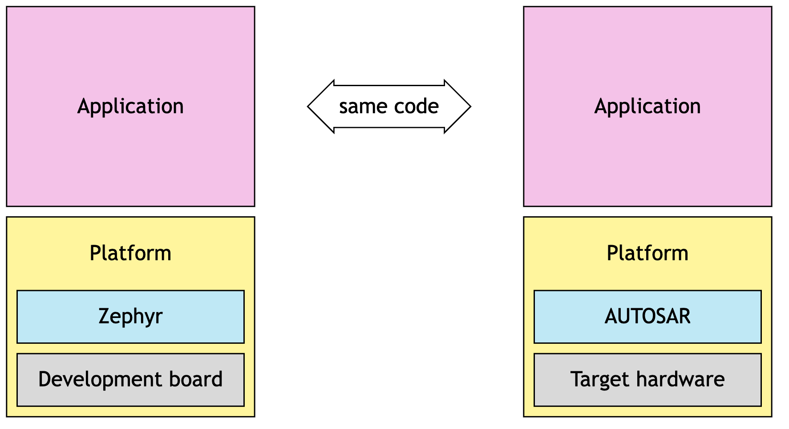
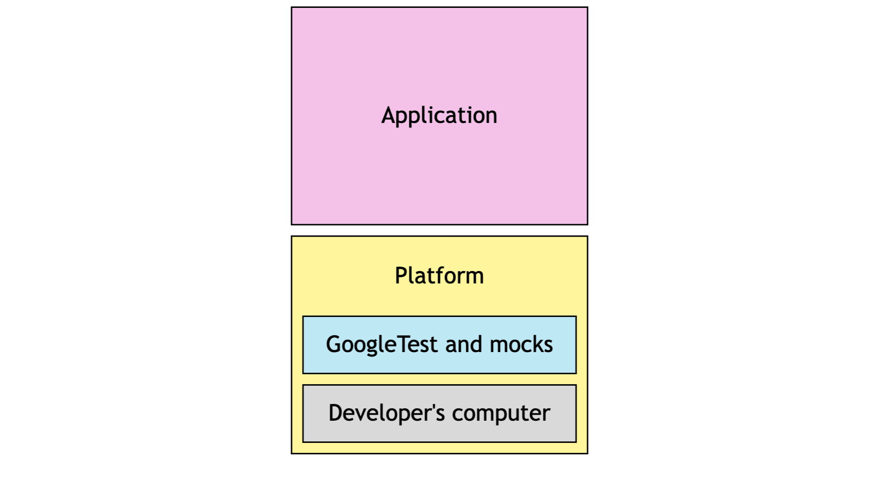
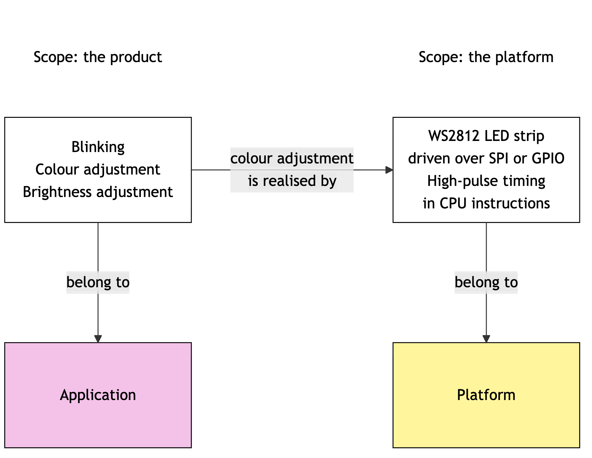

# There Is More to a Product Line Than Zephyr Boards

Asking the SPLE Question First

Alexandru Maxiniuc, Marquardt GmbH

Most embedded teams choose the real-time operating system first and meet the variant problem later, when the build system, the configuration model and the way components are wired are already fixed. Software Product Line Engineering (SPLE), building a family of related products from one code base, sits one layer above that choice. This article derives requirements for the build environment of an embedded product line from the needs of a project and a small example, then evaluates Zephyr, spl-core and yanga against them. The product line question and the basic software question turn out to be separate decisions.

## Needs at the start of an embedded project

When the software work on a new embedded product starts, the team needs four things. The first is fast feedback, at least unit tests on the developer's computer. The second is a prototype on a development board, because the real hardware arrives late and a demonstrator is often needed early. The third is the same software running on the target hardware once that hardware is there, without rewriting everything that already runs on the prototype. The fourth is documentation and reports, which series development in regulated domains such as automotive or medical devices requires.

Imagine a company with two departments. An advance development team builds prototypes on Zephyr, because its many supported boards make trying out a function on real hardware quick. The business unit builds series products on AUTOSAR. The prototype is meant to become the product, so the application, where the business logic sits, should run on both. Prototype and series product live side by side in one repository, and each build chooses which of the two it produces (Figure 1).



Figure 1: The same application on two platforms: a prototype on Zephyr and a series product on AUTOSAR. A platform is a middle layer plus the hardware.

The first platform, however, is the developer's computer, where unit tests give the fastest feedback. With a test framework and mocks in place of the middle layer, the host is a platform too (Figure 2).



Figure 2: The host as a platform: a test framework with mocks instead of a middle layer, and the developer's computer as hardware.

The first three needs ask for the same product on the host, on the development board and on the target hardware. Two requirements follow from this.

*R1 One product, several platforms.* From one repository, the same product builds for the host, for the development board and for the target hardware without changes to the application components.

*R2 A new platform leaves the products unchanged.* When the target hardware arrives, it is added as a new platform. Adding it does not change the existing products.

The fourth need comes from regulated series development: documents and test reports that show which code, tests and feature selection belong to each delivered product on each platform.

*R3 Documentation and reports.* The build environment produces the documentation and the reports for every product and platform it builds.

## Product line terms

This chapter introduces the terms the requirements build on: feature, variant, platform and component. It uses SPLed, a small open source product line around one LED, as a running example [1, 2, 3]. One customer asked for a disco light: the LED blinks, and the colour and the blinking frequency can be adjusted. Another customer asked for a sleep light: the LED keeps a constant colour, and the user can adjust its brightness.

### Features and variants

A product line starts with the customer requirements. They are analysed for what all products have in common and where they differ. Every difference becomes a feature: a switch that enables a part of the product for the customers who need it. The disco light needs blinking, the sleep light a brightness adjustment. The set of features and the rules between them is the feature model. The settings of all features for one product are its feature selection.

*R4 Feature model.* One can model the features of the line with their rules, so that every artefact that differs between variants is configured from one source and an invalid feature selection is caught before the build. The code reads the selection as a C header, the documentation in a format of its own.

The code is split into components. A variant is one product of the line and uses the components that implement its features.

*R5 Variant model.* One can define each variant with its name, description, feature selection and components, so that the build produces any variant from its definition and the reports can say what was built.

### Platforms

The variant says what the product does, the platform where it runs: a middle layer such as Zephyr, AUTOSAR or a custom operating system, plus the hardware (Figure 1). A variant names no board, so the same variant builds on every platform.

*R6 Platform model.* One can define platforms, each with its middle layer, its hardware and its own components, such as board drivers or host test doubles, separately from the variants, so that one variant builds on several platforms and a new platform is added without changing the variants.

### Components

A component is a part of the code that a variant or a platform uses as a whole, such as the light controller of the disco light. In SPLed every component is a folder with its sources, unit tests and documentation side by side, so each can be tested, documented and reported on its own.

*R7 Component model.* One can define components with their production, test and documentation files, so that any variant or platform can use them and the reports find the tests and documents of each component.

### Product features and platform features

The features of a product line do not all have the same scope.

The first kind describes what the product does: blinking, an adjustable colour, an adjustable brightness. Their scope is the product. If the electronics or the operating system change, the disco light still blinks and its colour can still be adjusted.

The second kind describes how one particular platform realises the product. In the disco light the colour comes from a WS2812 LED strip. On Zephyr the strip can be driven over the Serial Peripheral Interface (SPI) or by switching a general-purpose input/output pin (GPIO) [4]. The customer never sees these options. They are specific to one platform, and setting them takes know-how of that platform. Their scope is the platform.

Figure 3 shows the two scopes and where they belong.



Figure 3: Two scopes of features and where they belong.

*R8 Two feature models.* Features scoped to the product and features scoped to the platform are kept in two separate feature models, one for the application and one for the platform, so that application code cannot come to depend on the options of one platform.

*R9 Selections by owner.* The variant, the platform and the variant on one platform each have their own selection, in its own place, so that a change to the platform does not touch the selection of the variant, and the other way round.

### Defining, viewing and using the models

The terms above describe what a product line is made of. Working with it means adding a variant for a new customer, a feature for a new requirement, a component for a new function, or a platform when new hardware arrives. Others want to see which variants exist and what they contain, and tools such as the build tool, the test runner, the generators and the continuous integration read the same information.

Defining, viewing and using all get easier when the models are written down in configuration files. Adding a variant is a new entry, not a change to a build script. Seeing what a variant contains means reading a configuration file, not running the build tool. The models then no longer depend on one build system or one programming language. One parser reads them, and different generators produce what each tool needs: the files for the build system, the reports, the documentation, or the views of an IDE extension.

*R10 Models as data.* The models are declared in configuration files, independent of the build system, so that one can define, view and use them without running the build tool, and generators can produce what each tool needs.

## Evaluation of Zephyr, spl-core and yanga

Table 1 lists where Zephyr, spl-core and yanga keep the four models, Table 2 which requirements each meets.

```text
Model     Zephyr          spl-core       yanga
Feature   Kconfig         Kconfig        Kconfig, two
                                         models
Variant   conf files per  folder with    YAML: selection
          FILE_SUFFIX     CMake files    and components
Component CMake, sources  CMake macro    YAML list,
          by Kconfig      calls          CMake generated
Platform  boards,         prod or test   YAML, any
          devicetree                     number
```

Table 1: The four models per tool.


```text
Req  Zephyr          spl-core        yanga
R1   yes             partly          yes
R2   yes             no              yes
R3   partly, tests   partly, tests   yes
R4   partly          partly          partly
R5   partly, suffix  yes             yes
R6   yes, boards     partly          yes
R7   partly, CMake   partly, CMake   yes
R8   no, one tree    no              yes
R9   yes             no              yes
R10  partly          partly, JSON    yes
```

Table 2: Requirements met per tool.


Zephyr is a configurable platform and covers the platform side of the requirements in depth. A board is a platform: devicetree describes the hardware, Kconfig the options, and a west manifest the repositories. Adding a board leaves the application unchanged, and the host has two boards of its own: native_sim runs the whole system on the developer's computer, and unit_testing links only the code under test with Ztest. Twister reports tests and coverage per board, but not documentation. The selections follow their owners: the board's defconfig for the platform, prj.conf for the application, and boards/<BOARD>.conf for the application on one board [5]. The options of the application and of the system sit in one Kconfig tree. Further variants are configuration files chosen with FILE_SUFFIX, and Kconfig options inside CMake decide which sources are built.

spl-core adds a variant model in plain CMake: each variant is a folder with its feature selection and a CMake file that adds its components. Its platform axis has two values: the production build, and the test build with host tests, documentation and reports. One Kconfig tree holds all features, with one selection per variant. The component model stays in CMake and is exported to JSON during configuration, one variant at a time [6].

yanga keeps the models in YAML files and generates the CMake build from them. Variants, platforms and components are data, and the variant names its components and its selections, as Figure 4 shows. In SPLed one variant builds for the host, Zephyr boards and a bare-metal target, each with its report. The product feature model and the platform feature model are separate; in the example the platform model of the Zephyr platforms is Zephyr's own Kconfig tree. yanga-core collects the YAML files and prints the model as JSON for other tools. Today the only generator produces CMake [7].

```text
variants:
    - name: Disco
      components:
          - rte
          - spled
          - light_controller
          - power_button
          - main_control_knob
      feature_selection:
          file: variants/Disco/config.txt
      platforms:
          zephyr_esp32h2:
              feature_selection:
                  file: variants/Disco/zephyr_esp32h2.txt
```

Figure 4: The Disco variant in yanga, shortened. Source: [2].

## Summary

A product line is more than a set of boards. It needs four models, for features, variants, platforms and components, declared as data, and a build environment that produces every variant from them. Which of these fits depends on which requirements weigh most. The application and the variants can be kept independent of the basic software, so that a prototype on Zephyr and a series product on AUTOSAR are two platforms of one product line.

## References

[1] SPLed, spl-core port: https://github.com/avengineers/SPLed

[2] SPLed, yanga port: https://github.com/cuinixam/SPLedy

[3] SPLed, Zephyr port: https://github.com/cuinixam/SPLedz

[4] Zephyr, WS2812 LED strip driver options: drivers/led_strip/Kconfig.ws2812 in https://github.com/zephyrproject-rtos/zephyr

[5] Zephyr, Setting Kconfig configuration values: https://docs.zephyrproject.org/latest/build/kconfig/setting.html

[6] spl-core: https://github.com/avengineers/spl-core

[7] yanga: https://github.com/cuinixam/yanga

## The author

Alexandru has nearly 20 years of experience in the automotive industry, where he specialised in safety-critical embedded software for braking systems. He is a Senior Platform Engineer in the Rhine-Main Team (RMT) of Marquardt GmbH, where he works on build environments and Software Product Line Engineering for embedded teams. He develops and contributes to open source tools for this, among them spl-core and yanga.
