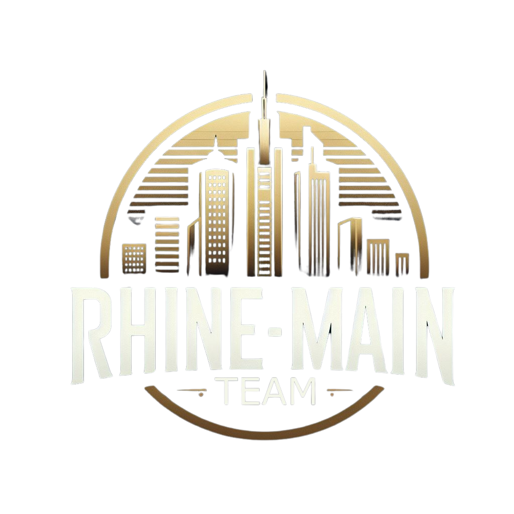

## There Is More to a Product Line Than Zephyr Boards

Asking the SPLE Question First

ESE Kongress 2026 in Sindelfingen <!-- .element: class="ese-event" -->

Note:

Welcome the audience. Say the title of the talk.

---

### Who am I?

Alexandru

Note:

Each speaker says who they are in one or two sentences.

---

<!-- .slide: data-background-color="#008080" -->

🌐 Alexandru Maxiniuc - Homepage - Microsoft Internet Explorer<b>_</b><b>□</b><b>✕</b>

<u>F</u>ile<u>E</u>dit<u>V</u>iewF<u>a</u>vorites<u>T</u>ools<u>H</u>elp

◀ Back▶✖ Stop⟳ Refresh⌂ Home🔍 Search★ Favorites

A<u>d</u>dresshttp://www.maxiniuc.com/➜ Go

<marquee scrollamount="6">*** Welcome to my homepage!!! *** Thank you for visiting *** Please sign my guestbook ***</marquee>

Alexandru Maxiniuc

I am interested in engineering software product lines, software architecture and build systems.

NEW! Updated for the ESE Kongress 2026

UNDER CONSTRUCTION

<a>[ About me ]</a> <a>[ My projects ]</a> <a>[ Guestbook ]</a> <a>[ Links ]</a> <a>[ Webring ]</a>

You are visitor number 000042

Best viewed with Internet Explorer 5.0 at 800x600

Done🌐 Internet

Note:

The old homepage, "updated for the conference". The sentence on the page is from the About page of maxiniuc.com.

---

// the thread

<ol class="rail">
<li class="now">Two customers, one product line</li>
<li>From wishes to features</li>
<li>A prototype on Zephyr</li>
<li>The series project starts</li>
<li>What it really takes</li>
<li>A better way</li>
<li>Three tools, side by side</li>
<li>Back to the start</li>
</ol>

We follow one product line from the first customer e&#8209;mail to the series product.

Along the way, we collect what the development environment needs.

Note:

The common thread, not an agenda: one product line, from the e-mail to series production, and the requirements we find on the way.

---

// context

We are a supplier. We build SPLed, a small light controller, for two customers.

Customer A

Customer B

Note:

Section 1, context, about 2 minutes. One code base, two customers. Each customer sees only their own product: in the code, in the binary and in the documents.

---

<!-- .slide: data-auto-animate data-auto-animate-id="fm" -->

// customer input

From: Customer A Subject: light for our party room

We need a light for our party room. It shall blink so people notice it. Please make it green. We want to switch it on and off with one button.

From: Customer B Subject: bedroom lights

Our hotel needs a calm light for the bedrooms. Guests shall dim it by hand. A soft purple works best. And of course a button to switch it on and off.

Note:

Section 2, the domain, about 5 minutes. Read both mails as they arrive. Step 1: what both want. Step 2: what only one of them wants. Next slide: the marked words leave the mails.

---

<!-- .slide: data-auto-animate data-auto-animate-id="fm" data-background-color="#0000a8" -->

// features

// variants

SPLed light

<ul class="mc-list">
<li>[ ] Blinking</li>
<li>[ ] Manual dimming</li>
<li>&nbsp;&nbsp;&nbsp; Color ---&gt;</li>
<li>&nbsp;&nbsp;&nbsp;&nbsp;&nbsp;&nbsp;( ) green</li>
<li>&nbsp;&nbsp;&nbsp;&nbsp;&nbsp;&nbsp;( ) purple</li>
</ul>

Disco
<ul class="mc-list"><li>[*] Blinking</li><li>[ ] Manual dimming</li><li>(X) green</li></ul>

Sleep
<ul class="mc-list"><li>[ ] Blinking</li><li>[*] Manual dimming</li><li>(X) purple</li></ul>

⚠ Development environment✕

<b>New requirement detected</b>Your development environment does not meet it yet.

Remind me laterOpen

Note:

The words only one customer wrote are now the menu. What both want is not modelled: there is nothing to toggle. The round brackets mean pick one. Then the two selections: two variants, each a name and a feature selection. Components join the variant later.

---

<!-- .slide: data-background-color="#0000a8" data-auto-animate data-auto-animate-id="fm" -->

.config - development environment for a product line

Requirements

Collected along the story. <b>&lt;Y&gt;</b> includes, <b>&lt;N&gt;</b> excludes, <b>&lt;?&gt;</b> asks the speaker.

<ul class="mc-list">
<li class="fragment cursor">[*] Feature model</li>
<li class="fragment cursor">[*] Variant model</li>
</ul>

&lt;Select&gt;&lt; Exit &gt;&lt; Help &gt;&lt; Save &gt;&lt; Load &gt;

Note:

First ticks: a feature model, with its rules, as the single source of what differs; and a variant model that names each product and its selection.

---

// the prototype

Application: SPLed components

Zephyr RTOS
SubsystemsShellLogging

Device driversGPIOLED strip (WS2812)

KernelThreadsTimers

ESP32-H2 dev board

The innovation team builds the first prototypes on Zephyr.

Note:

Section 3, the prototype. The colleagues from the innovation department start. They pick Zephyr: boards, drivers, shell and logging come with it, and the dev board runs within days.

---

<!-- .slide: data-background-color="#0000a8" -->

.config - Zephyr Kernel Configuration

Zephyr Kernel Configuration

Arrow keys navigate the menu. <b>&lt;Enter&gt;</b> selects submenus ---&gt;.

<ul class="mc-list">
<li class="fragment cursor">&nbsp;&nbsp;&nbsp; Features ---&gt;</li>
<li>&nbsp;&nbsp;&nbsp; Modules ---&gt;</li>
<li>&nbsp;&nbsp;&nbsp; Board Options ---&gt;</li>
<li>&nbsp;&nbsp;&nbsp; Hardware Configuration ---&gt;</li>
<li>&nbsp;&nbsp;&nbsp; General Kernel Options ---&gt;</li>
<li>&nbsp;&nbsp;&nbsp; Device Drivers ---&gt;</li>
<li>&nbsp;&nbsp;&nbsp; C Library ---&gt;</li>
<li>&nbsp;&nbsp;&nbsp; Subsystems and OS Services ---&gt;</li>
<li>&nbsp;&nbsp;&nbsp; Build and Link Features ---&gt;</li>
<li>&nbsp;&nbsp;&nbsp; Boot Options ---&gt;</li>
</ul>

&lt;Select&gt;&lt; Exit &gt;&lt; Help &gt;&lt; Save &gt;&lt; Load &gt;

Note:

Zephyr comes with Kconfig, a language for feature models, and kconfiglib, the Python tool that draws this menu (west build -t menuconfig). The application can add its own Kconfig. The innovation team is happy: two lines in app/Kconfig, and the SPLed features sit in the same menu as the Zephyr options. The menu is abridged; the entries are the real top-level menus of Zephyr.

---

// debugging without the board

Application: SPLed components

+ ztest unit tests

Zephyr RTOS
SubsystemsShellLogging

Device driversGPIOLED strip (WS2812)

KernelThreadsTimers

ESP32-H2 dev board

native_sim on the laptop

Bugs are reproduced in unit tests on the host, not on the board.

Note:

The first bugs come in. Debugging on the board is slow, so the team reproduces each problem in a unit test that runs on the laptop: Zephyr's native_sim board and ztest.

---

<!-- .slide: data-auto-animate data-auto-animate-id="fm2" -->

// variants × platforms

<b>Disco</b>Blinking, green

<b>Sleep</b>Manual dimming, purple

Dev board<small>Zephyr</small>

prototype ✓

prototype ✓

Series board<small>AUTOSAR, in-house hardware</small>

?

?

Note:

Each customer saw only their own demo. Then series development starts on another platform. Two empty cells.

---

<!-- .slide: data-auto-animate data-auto-animate-id="just" -->

“Just port it.”*

Note:

Section 4, about 2 minutes. Say it like the manager. Pause. Ask the room what they would do.

---

<!-- .slide: data-auto-animate data-auto-animate-id="just" -->

“Just port it.”*

<b>Application</b>

Zephyr

Dev board

AUTOSAR + RTE

Series board, in-house

Note:

This is how "just port it" looks from the manager's desk. The application is one block.

---

<!-- .slide: data-auto-animate data-auto-animate-id="just" -->

“Just port it.”*

<b>Application</b>

Zephyr

Dev board

AUTOSAR + RTE

Series board, in-house

Just move it over.

Note:

Pick it up, put it down. Next slide: open the block and look inside.

---

<!-- .slide: data-auto-animate data-auto-animate-id="tangled" -->

// what is inside the block

light_controller

brightness_controller

power_signal_proc.

main_control_knob

power_button

led_interface

button_interface

rte

Zephyr

Dev board

Red: components that call Zephyr directly.

Note:

Section 5, why it is not just, about 6 minutes. The components of SPLed. The red ones include Zephyr headers, call the kernel and use devicetree macros. It was the fastest way to get the demo running.

---

<!-- .slide: data-auto-animate data-auto-animate-id="tangled" -->

// just port it

light_controller

brightness_controller

power_signal_proc.

main_control_knob

rte

AUTOSAR + RTE

Series board, in-house

Port = rewrite every red tile.

power_button

led_interface

button_interface

Zephyr

Note:

The platform leaves, and the red tiles leave with it. The holes are the work.

---

<!-- .slide: data-auto-animate data-auto-animate-id="bill" -->

“Just port it.”*

<ol class="bill abs" style="left:40px; top:100px;">
<li class="fragment"><em>*</em> Replace every Zephyr call in the application</li>
<li class="fragment"><em>*</em> Describe every component again for AUTOSAR</li>
<li class="fragment"><em>*</em> Dig the two variants out of <code>prj.conf</code> files</li>
<li class="fragment"><em>*</em> Move the component list out of CMake</li>
<li class="fragment"><em>*</em> Rewrite the tests that ran under twister</li>
<li class="fragment"><em>*</em> Rebuild CI and relearn every tool</li>
</ol>

Note:

The asterisk is the small print of "just". One line per click. At the prj.conf line, say why: product options and board options sit in the same file, so someone has to sort them by hand.

---

<!-- .slide: data-auto-animate data-auto-animate-id="bios3" -->

// a day on the prototype team

~/.zsh_history

101west build -b esp32h2_devkitm app -- -DFILE_SUFFIX=disco

→ open the vendor configurator, export ARXML, run the RTE generator

102west build -t menuconfig

→ a different tool, a different file format

103west twister -p native_sim -T app

→ no simulator target, tests need a new home

104west flash

→ the vendor's flash script and debugger

⚠ Development environment✕

<b>New requirement detected</b>Your development environment does not meet it yet.

Remind me laterOpen

Note:

Not the code this time: the commands. Each one belongs to the platform. The way of working moves out with Zephyr.

---

<!-- .slide: data-background-color="#0000a8" data-auto-animate data-auto-animate-id="bios3" -->

.config - development environment for a product line

Requirements

Collected along the story. <b>&lt;Y&gt;</b> includes, <b>&lt;N&gt;</b> excludes, <b>&lt;?&gt;</b> asks the speaker.

<ul class="mc-list">
<li>[*] Feature model</li>
<li>[*] Variant model</li>
<li class="fragment cursor">[*] One product, several platforms</li>
<li class="fragment cursor">[*] A new platform leaves the products unchanged</li>
<li class="fragment cursor">[*] Product and platform choices in separate files</li>
</ul>

&lt;Select&gt;&lt; Exit &gt;&lt; Help &gt;&lt; Save &gt;&lt; Load &gt;

Note:

What the manager asked for, written as requirements.

---

<!-- .slide: data-auto-animate data-auto-animate-id="shell" -->

// with a thin shell

light_controller

brightness_controller

power_signal_proc.

main_control_knob

power_button

led_interface

button_interface

rte

zephyr shell: adapters for led, button, timer

Zephyr

Dev board

No component includes a platform header.

Note:

Section 6, can we improve, about 5 minutes. Same components. The only code that knows Zephyr is the shell.

---

<!-- .slide: data-auto-animate data-auto-animate-id="shell" -->

// just port it, again

light_controller

brightness_controller

power_signal_proc.

main_control_knob

power_button

led_interface

button_interface

rte

autosar shell: one SWC, RTE ports as adapters

AUTOSAR + RTE

Series board, in-house

Port = write a new shell.

zephyr shell: adapters for led, button, timer

Zephyr

Note:

The platform leaves with its shell. Every tile stays. This is the answer the manager wanted.

---

<!-- .slide: data-auto-animate data-auto-animate-id="bios1" -->

// the same light, four altitudes

<small>customer · sales</small>“A green light that blinks.”

<small>product features · system engineer</small>BLINKING=y &nbsp; COLOR_GREEN=y

<small>platform features · software engineer</small>WS2812_STRIP_SPI=y

<small>platform value · hardware engineer</small>DELAY_T1H = 700 ns × CPU clock / 10⁹ (number of NOPs for a high bit)

⚠ Development environment✕

<b>New requirement detected</b>Your development environment does not meet it yet.

Remind me laterOpen

Note:

The platform changes, the customer's sentence does not. Each click goes one level down. The room recognises their own level. The DELAY_T1H default is the real formula from Zephyr's Kconfig.

---

<!-- .slide: data-background-color="#0000a8" data-auto-animate data-auto-animate-id="bios1" -->

.config - development environment for a product line

Requirements

Collected along the story. <b>&lt;Y&gt;</b> includes, <b>&lt;N&gt;</b> excludes, <b>&lt;?&gt;</b> asks the speaker.

<ul class="mc-list">
<li>[*] Feature model</li>
<li>[*] Variant model</li>
<li>[*] One product, several platforms</li>
<li>[*] A new platform leaves the products unchanged</li>
<li>[*] Product and platform choices in separate files</li>
<li class="fragment cursor">[*] Platform model</li>
<li class="fragment cursor">[*] Two feature models</li>
</ul>

&lt;Select&gt;&lt; Exit &gt;&lt; Help &gt;&lt; Save &gt;&lt; Load &gt;

Note:

The platform is a model of its own: middle layer, hardware and its own components, such as the shell. And its features live in a feature model of their own.

---

<!-- .slide: data-auto-animate data-auto-animate-id="comp" -->

// a component

light_controller

Note:

One tile from the stack. Next click: open it.

---

<!-- .slide: data-auto-animate data-auto-animate-id="comp" -->

// a component

<b>light_controller</b> &nbsp; scope: SPL 
code src/light_controller.c, .h 
tests test/test_light_controller.cc 
docs doc/index.md 
features KConfig

⚠ Development environment✕

<b>New requirement detected</b>Your development environment does not meet it yet.

Remind me laterOpen

Note:

A component is not a source file. It carries its code, its tests, its docs and its own options, and it says where it belongs: the whole SPL, one variant, one platform, or one pair.

---

<!-- .slide: data-background-color="#0000a8" data-auto-animate data-auto-animate-id="comp" -->

.config - development environment for a product line

Requirements

Collected along the story. <b>&lt;Y&gt;</b> includes, <b>&lt;N&gt;</b> excludes, <b>&lt;?&gt;</b> asks the speaker.

<ul class="mc-list">
<li>[*] Feature model</li>
<li>[*] Variant model</li>
<li>[*] One product, several platforms</li>
<li>[*] A new platform leaves the products unchanged</li>
<li>[*] Product and platform choices in separate files</li>
<li>[*] Platform model</li>
<li>[*] Two feature models</li>
<li class="fragment cursor">[*] Component model</li>
</ul>

&lt;Select&gt;&lt; Exit &gt;&lt; Help &gt;&lt; Save &gt;&lt; Load &gt;

Note:

Components with their production, test and documentation files.

---

<!-- .slide: data-auto-animate data-auto-animate-id="bios7" -->

// who can read your model?

<svg class="readers-lines abs" width="880" height="470" style="left:0; top:0;">
<line x1="420" y1="120" x2="600" y2="40"/>
<line x1="420" y1="140" x2="600" y2="110"/>
<line x1="420" y1="160" x2="600" y2="180"/>
<line x1="420" y1="180" x2="600" y2="250"/>
<line x1="420" y1="400" x2="600" y2="400"/>
</svg>

variants/Disco/yanga.yaml
- name: Disco
  components:
  - rte
  - spled
  - light_application
  feature_selection:
    file: variants/Disco/config.txt

app/CMakeLists.txt
target_sources_ifdef(CONFIG_SHELL
    app PRIVATE src/buttons_shell.c)

the build

the variant report

the docs build

the CI matrix

the build

⚠ Development environment✕

<b>New requirement detected</b>Your development environment does not meet it yet.

Remind me laterOpen

Note:

Data has many readers. Code has one: the tool that runs it. Same idea as a GitHub workflow file: GitHub draws the job graph from it without running it.

---

<!-- .slide: data-background-color="#0000a8" data-auto-animate data-auto-animate-id="bios7" -->

.config - development environment for a product line

Requirements

Collected along the story. <b>&lt;Y&gt;</b> includes, <b>&lt;N&gt;</b> excludes, <b>&lt;?&gt;</b> asks the speaker.

<ul class="mc-list">
<li>[*] Feature model</li>
<li>[*] Variant model</li>
<li>[*] One product, several platforms</li>
<li>[*] A new platform leaves the products unchanged</li>
<li>[*] Product and platform choices in separate files</li>
<li>[*] Platform model</li>
<li>[*] Two feature models</li>
<li>[*] Component model</li>
<li class="fragment cursor">[*] Documentation and reports</li>
<li class="fragment cursor">[*] Models as data</li>
</ul>

&lt;Select&gt;&lt; Exit &gt;&lt; Help &gt;&lt; Save &gt;&lt; Load &gt;

Note:

Models as data, and the readers that need them: reports and documentation.

---

// where does Disco live?

<h4>Zephyr</h4>

app/prj_disco.conf
CONFIG_GPIO=y
CONFIG_SHELL=y
CONFIG_BLINKING=y
CONFIG_COLOR_GREEN=y

app/CMakeLists.txt
target_sources_ifdef(
  CONFIG_SHELL ...)

<h4>spl-core</h4>

variants/Disco/config.txt
CONFIG_BLINKING=y
CONFIG_COLOR_GREEN=y

variants/Disco/parts.cmake
spl_add_component(
  components/light_controller)

<h4>yanga</h4>

variants/Disco/config.txt
CONFIG_BLINKING=y
CONFIG_COLOR_GREEN=y

variants/Disco/yanga.yaml
- name: Disco
  components: [rte, spled, ...]

Note:

Section 7, the three frameworks, about 6 minutes. The same variant in three tools, as the files show it. No scores: the audience sees where product and board options meet, and where the component list lives.

---

// TODO

More side-by-side slides: where the platform lives, where the components live, where the selections live. One question per slide, the real files of each tool as the answer.

Note:

Open: which questions get a slide. Candidates follow the requirements R1 to R10.

---

<!-- .slide: data-auto-animate data-auto-animate-id="close" -->

“Just port it.”

“Sure. New shell, same application.”

⚠ Development environment✕

<b>New requirement detected</b>Your development environment does not meet it yet.

Remind me laterOpen

Note:

Section 8, about 2 minutes. The opening line comes back, without the asterisk.

---

<!-- .slide: data-background-color="#0000a8" data-auto-animate data-auto-animate-id="close" -->

.config - development environment for a product line

Take a photo

Collected along the story. <b>&lt;Y&gt;</b> includes, <b>&lt;N&gt;</b> excludes, <b>&lt;?&gt;</b> asks the speaker.

<ul class="mc-list">
<li>[*] R1 One product, several platforms</li>
<li>[*] R2 A new platform leaves the products unchanged</li>
<li>[*] R3 Documentation and reports</li>
<li>[*] R4 Feature model</li>
<li>[*] R5 Variant model</li>
<li>[*] R6 Platform model</li>
<li>[*] R7 Component model</li>
<li>[*] R8 Two feature models</li>
<li>[*] R9 Product and platform choices in separate files</li>
<li>[*] R10 Models as data</li>
</ul>

&lt;Select&gt;&lt; Exit &gt;&lt; Help &gt;&lt; Save &gt;&lt; Load &gt;

Note:

The photo slide. Leave it up while people take pictures, then go to questions.

---

### Questions?

https://avengineers.github.io/ESE-2026/docs/zephyr_meets_sple/ <!-- .element: class="deck-url" -->

---

### Some Links

- [We@GitHub](https://github.com/avengineers)
- [Printable Slides](https://avengineers.github.io/ESE-2026/docs/zephyr_meets_sple/?print-pdf)
