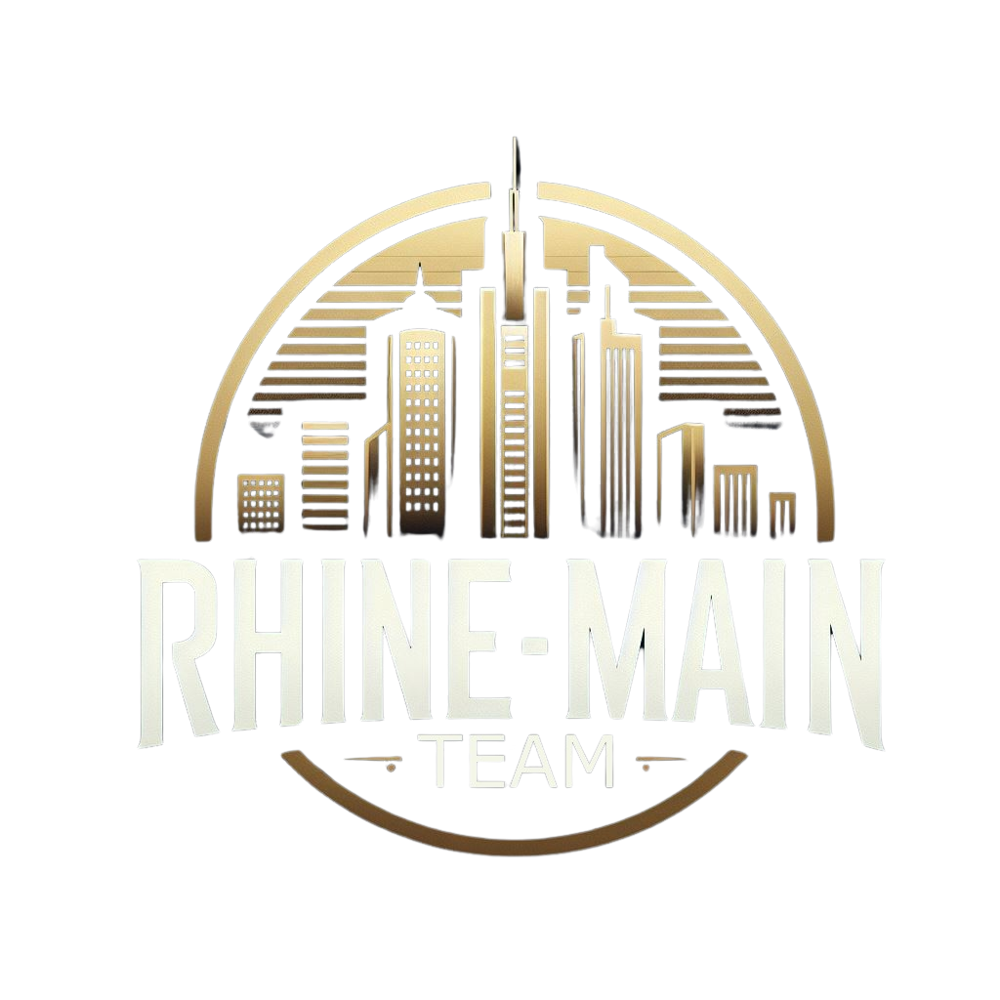
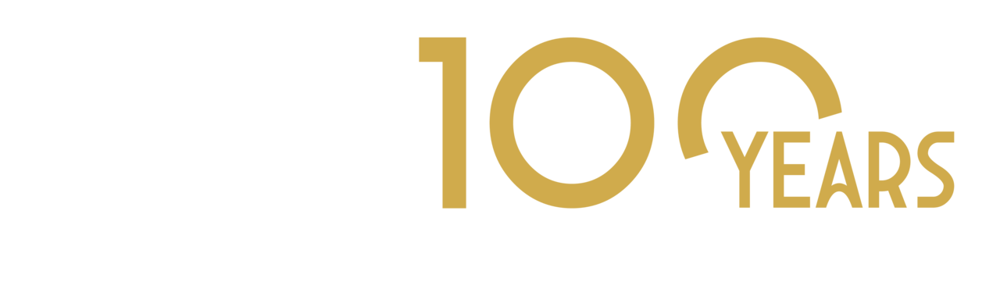

### Our Talks at the ESE Kongress 2026

[„Frag doch den Agenten!" – Wie agentische KI unseren Embedded-Entwicklungsalltag verändert hat](docs/ai_journey/) 
[Beyond Software: The Rise of "Engineering as Code" in Embedded Systems](docs/eng_as_code/) 
[There Is More to a Product Line Than Zephyr Boards](docs/zephyr_meets_sple/) 

